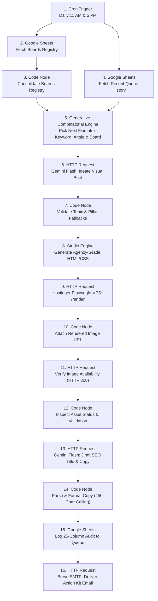

# Finmatrix Automated Pinterest Pin Generation System: Technical Audit Dossier

> **System Purpose:** Autonomous, keyword-driven Pinterest infographic generation and marketing pipeline for **Finmatrix** (`https://finmatrix.cloud`).  
> **Workflow File:** `workflows/finmatrix-pinterest-marketing-automation.json`  
> **Hostinger Render VPS:** `http://31.97.232.154:3000/render` (Public pins: `/pins/`)  
> **Target Audience for this Dossier:** Senior Software Engineers & Claude Technical Audit.

---

## 1. System Architecture & Flow Diagram

The system operates as an autonomous, closed-loop pipeline scheduled twice daily. It ingests SEMrush keyword data, selects balanced topics avoiding recent duplicates, generates quantitative data via Gemini AI, constructs ultra-dense HTML/CSS graphics, renders them via headless Playwright on a remote VPS, validates the asset via HTTP 200, drafts SEO metadata, audits the record to Google Sheets, and delivers an Action Kit briefing email via Brevo.



---

## 2. Complete Node-by-Node Verbatim Specification

### Node 1: Schedule Trigger (Cron)
- **Node Name:** `Cron: Daily 11 AM & 5 PM (Pinterest Peak Hours)`
- **Type:** `n8n-nodes-base.scheduleTrigger`
- **Execution Interval:** `0 11,17 * * *` (11:00 AM & 5:00 PM).
- **Output:** Triggers execution run with execution timestamp.

---

### Node 2 & Node 3: Boards Registry Ingestion
- **Node 2:** `Fetch Boards Registry from Google Sheets` (`n8n-nodes-base.googleSheets`)
  - **Sheet ID:** `1sPshk7V0i767_HhxnBQoCbomr3g0VevbeffA3gKhU4k`
  - **Tab:** `Finmatrix_Pinterest_Boards`
  - **Operation:** Read all rows.
- **Node 3:** `Consolidate Boards Registry` (`n8n-nodes-base.code`)
  - **Logic:**
    ```javascript
    const items = $input.all();
    const boards = items.map(item => item.json).filter(b => b.BoardID && b.IsActive !== false && b.IsActive !== 'FALSE');
    return [{ json: { boards, count: boards.length } }];
    ```

---

### Node 4: Queue History Deduplication Reader
- **Node Name:** `Fetch Recent Queue History from Google Sheets` (`n8n-nodes-base.googleSheets`)
- **Sheet ID:** `1sPshk7V0i767_HhxnBQoCbomr3g0VevbeffA3gKhU4k`
- **Tab:** `Finmatrix_Pinterest_Queue`
- **Operation:** Read all rows (last 15 rows used to enforce dynamic recency dedup).

---

### Node 5: Combinatorial Generative Engine
- **Node Name:** `Pick Next Finmatrix Keyword, Angle & Board` (`n8n-nodes-base.code`)
- **Function:** Ingests 1,360 sanitized master keywords, checks the last 15 published keywords, selects the next keyword, determines search intent (`COMPARE`, `CALCULATOR`, `ROADMAP`, `FRAMEWORK`, `TABLE_CHECKLIST`), pairs it with an archetype and Pinterest board, and generates a unique `pinId`.
- **Verbatim JavaScript Code:**
```javascript
const masterKeywords = [/* 1,360 sanitized keywords from SEMrush */];

const defaultBoardsRegistry = [
  { BoardID: "BOARD-01", BoardName: "Personal Finance & Wealth Building", PreferredDestinationURL: "https://finmatrix.cloud/calculators/debt-elimination-planner.html", IsActive: true },
  { BoardID: "BOARD-02", BoardName: "Debt Free Journey & Payoff Strategies", PreferredDestinationURL: "https://finmatrix.cloud/calculators/debt-elimination-planner.html", IsActive: true },
  { BoardID: "BOARD-03", BoardName: "Retirement Planning & 401(k) Calculators", PreferredDestinationURL: "https://finmatrix.cloud/calculators/401k-calculator.html", IsActive: true },
  { BoardID: "BOARD-04", BoardName: "Mortgage, Home Loans & Refinance", PreferredDestinationURL: "https://finmatrix.cloud/calculators/home-affordability-calculator.html", IsActive: true },
  { BoardID: "BOARD-05", BoardName: "High-Yield Savings & Compound Interest", PreferredDestinationURL: "https://finmatrix.cloud/calculators/compound-interest-calculator.html", IsActive: true }
];

function mapKeywordToBoard(kw) {
  const k = kw.toLowerCase();
  if (k.includes('debt') || k.includes('credit') || k.includes('payoff') || k.includes('avalanche') || k.includes('snowball')) return "Debt Free Journey & Payoff Strategies";
  if (k.includes('401k') || k.includes('roth') || k.includes('ira') || k.includes('retire') || k.includes('fire')) return "Retirement Planning & 401(k) Calculators";
  if (k.includes('mortgage') || k.includes('home') || k.includes('rent') || k.includes('refinance') || k.includes('house')) return "Mortgage, Home Loans & Refinance";
  if (k.includes('hysa') || k.includes('cd') || k.includes('compound') || k.includes('savings') || k.includes('emergency fund') || k.includes('deposit') || k.includes('drain')) return "High-Yield Savings & Compound Interest";
  return "Personal Finance & Wealth Building";
}

let boardsList = defaultBoardsRegistry;
try {
  const gsheetBoards = $('Consolidate Boards Registry').first().json.boards || [];
  if (gsheetBoards.length > 0) {
    boardsList = defaultBoardsRegistry.map(def => {
      const match = gsheetBoards.find(b => b.BoardName && b.BoardName.toLowerCase() === def.BoardName.toLowerCase());
      return match ? { ...def, ...match } : def;
    });
  }
} catch (e) {}

let pastKeywords = [];
let pastArchetypes = [];
try {
  const recentHistory = $('Fetch Recent Queue History from Google Sheets').all();
  pastKeywords = recentHistory.map(item => (item.json.PrimaryKeyword || item.json.TargetKeyword || '').toLowerCase().trim()).filter(Boolean);
  pastArchetypes = recentHistory.map(item => item.json.PinStyle || item.json.Archetype || '').filter(Boolean);
} catch (e) {}

const recentWindow = pastKeywords.slice(-15);
let availableKeywords = masterKeywords.filter(k => !recentWindow.includes(k.keyword.toLowerCase().trim()));
if (availableKeywords.length === 0) availableKeywords = masterKeywords;

const selectedKwObj = availableKeywords[Math.floor(Math.random() * availableKeywords.length)];
const targetKeyword = selectedKwObj.keyword;
const keywordVolume = selectedKwObj.volume || 1000;
const keywordKD = selectedKwObj.kd || 15;
const keywordIntent = selectedKwObj.intent || 'Commercial';
const keywordPillar = selectedKwObj.pillar || 'Personal Finance';

const targetBoardName = mapKeywordToBoard(targetKeyword);
const selectedBoard = boardsList.find(b => b.BoardName === targetBoardName) || boardsList[0];

// Determine Intent Type
let intentType = 'CALCULATOR';
const kwLower = targetKeyword.toLowerCase();
if (kwLower.includes('vs') || kwLower.includes('difference') || kwLower.includes('compare') || kwLower.includes('or')) {
  intentType = 'COMPARE';
} else if (kwLower.includes('roadmap') || kwLower.includes('plan') || kwLower.includes('blueprint') || kwLower.includes('steps') || kwLower.includes('milestone') || kwLower.includes('journey')) {
  intentType = 'ROADMAP';
} else if (kwLower.includes('rule') || kwLower.includes('levers') || kwLower.includes('framework') || kwLower.includes('tips') || kwLower.includes('ways') || kwLower.includes('cheat sheet') || kwLower.includes('hacks') || kwLower.includes('pillars')) {
  intentType = 'FRAMEWORK';
} else if (kwLower.includes('rates') || kwLower.includes('table') || kwLower.includes('matrix') || kwLower.includes('checklist') || kwLower.includes('schedule') || kwLower.includes('audit')) {
  intentType = 'TABLE_CHECKLIST';
}

const archetypeRegistry = {
  CALCULATOR: [
    { id: 'ARCH_LAPTOP_WORKSPACE', name: 'Architectural Daylight Desk Calculator', badge: 'FREE CALCULATOR' },
    { id: 'ARCH_TABLET_MARBLE', name: 'Executive Tablet Wealth Simulator', badge: 'WEALTH SIMULATOR' }
  ],
  COMPARE: [
    { id: 'ARCH_COMP_MATRIX', name: '8-Row Head-to-Head Comparison Matrix', badge: 'STRATEGY COMPARISON' },
    { id: 'ARCH_BEFORE_AFTER', name: 'Quantitative Transformation Switch', badge: 'TRANSFORMATION' }
  ],
  ROADMAP: [
    { id: 'ARCH_ROADMAP_TIMELINE', name: '4-Phase Dense Action Blueprint', badge: 'FINANCIAL BLUEPRINT' }
  ],
  FRAMEWORK: [
    { id: 'ARCH_GRID_6_CARDS', name: '6-Card Wealth Levers Matrix', badge: 'WEALTH LEVERS' }
  ],
  TABLE_CHECKLIST: [
    { id: 'ARCH_TABLE_MATRIX', name: 'Financial Rate Matrix & Action Audit', badge: 'COMPARISON MATRIX' }
  ]
};

const candidates = archetypeRegistry[intentType] || archetypeRegistry.CALCULATOR;
const chosenArch = candidates[Math.floor(Math.random() * candidates.length)];

const pinId = 'FINPIN-' + new Date().toISOString().slice(0, 10).replace(/-/g, '') + '-' + Math.random().toString(36).substring(2, 6).toUpperCase();
const destinationBase = selectedBoard.PreferredDestinationURL || selectedKwObj.targetUrl || 'https://finmatrix.cloud/calculators/debt-elimination-planner.html';
const utmUrl = destinationBase + '?utm_source=pinterest&utm_medium=social&utm_campaign=' + (selectedBoard.BoardID || 'pin') + '&utm_content=' + pinId;

return [{
  json: {
    pinId: pinId,
    targetKeyword: targetKeyword,
    keywordVolume: keywordVolume,
    keywordKD: keywordKD,
    intentType: intentType,
    keywordIntent: keywordIntent,
    pillar: keywordPillar,
    boardId: selectedBoard.BoardID,
    targetBoard: selectedBoard.BoardName,
    destinationUrl: utmUrl,
    pinStyle: chosenArch.id,
    styleName: chosenArch.name,
    badgeText: chosenArch.badge,
    createdAt: new Date().toISOString()
  }
}];
```

---

### Node 6: Gemini API Visual Concept Generator
- **Node Name:** `Gemini API: Ideate Fresh Concept (Style-Specific)` (`n8n-nodes-base.httpRequest`)
- **Endpoint:** `POST https://generativelanguage.googleapis.com/v1beta/models/gemini-flash-lite-latest:generateContent?key=YOUR_GEMINI_API_KEY`
- **Prompt Structure:**
```
You are the Chief Quantitative Content Strategist for Finmatrix (https://finmatrix.cloud).
Generate mathematically accurate data for an ultra-dense, agency-grade Pinterest Infographic (1000x1500 vertical) tailored specifically to this user query:

TARGET SEARCH QUERY:
- Keyword: "${$json.targetKeyword}" (Vol: ${$json.keywordVolume} | KD: ${$json.keywordKD})
- Search Intent: ${$json.intentType}
- Assigned Archetype: ${$json.pinStyle} (${$json.styleName})
- Assigned Board: "${$json.targetBoard}"

STRICT BRAND COMPLIANCE:
1. Brand is strictly "Finmatrix" (https://finmatrix.cloud).
2. NEVER mention any other brand or domain (e.g. MyUSFinance, NerdWallet, Bankrate, SmartAsset, etc.).
3. The tool name must always be "Finmatrix " + Tool Name (e.g. "Finmatrix Amortization Engine", "Finmatrix Cash Depletion Simulator").

DATA REQUIREMENTS TO FILL 1000x1500 WITH ZERO BLANK SPACE:
- scriptTag: (Catchy handwritten badge, e.g. "Free & Easy to Use", "Head-to-Head Comparison", "Step-by-Step Blueprint")
- headlineOnImage: (Punchy 2-4 word uppercase title matching the query)
- subtitleOnImage: (Under 10 words clear educational subtitle)
- calcHeaderTitle: ("Finmatrix " + Specific Tool Name)

IF INTENT IS 'COMPARE':
- sideATitle, sideATag, sideBTitle, sideBTag
- row1Label, row1ValA, row1ValB (e.g. "Annual Contribution Limit", "$7,000 / year", "$23,000 / year")
- row2Label, row2ValA, row2ValB (e.g. "Current Tax Deduction", "No immediate deduction", "Immediate Tax Deduction")
- row3Label, row3ValA, row3ValB (e.g. "Company Employer Match", "None available", "50% - 100% Match")
- row4Label, row4ValA, row4ValB (e.g. "Retirement Withdrawals", "100% TAX-FREE", "Taxed as Ordinary Income")
- row5Label, row5ValA, row5ValB (e.g. "Early Withdrawal Penalty", "Withdraw contributions anytime", "10% IRS Penalty")
- row6Label, row6ValA, row6ValB (e.g. "Required Minimum Distributions", "ZERO RMDs Ever", "Mandatory at Age 73")
- row7Label, row7ValA, row7ValB (e.g. "Optimal Strategy Alignment", "Best if tax bracket is lower now", "Best if peak earning years")
- metricNumA, metricNumB: (e.g. "$1,480,000" vs "$2,140,000")
- verdictText: (1-sentence quantitative rule)

IF INTENT IS 'CALCULATOR':
- input1Label, input1Val, input2Label, input2Val, input3Label, input3Val, input4Label, input4Val
- heroResultLabel: (e.g. "Monthly Payment" or "Estimated Cash Runway")
- heroResultVal: (e.g. "$1,580.74" or "28.4 Months")
- subResult1Val, subResult2Val (e.g. "$569,064", "$319,064")
- check1, check2, check3, check4: (4 key quantitative takeaways)
- takeaway: (1-sentence practical rule for the notebook)

IF INTENT IS 'ROADMAP':
- phase1Title, phase1Amount, phase1Desc, phase1Action1, phase1Action2, phase1Action3
- phase2Title, phase2Amount, phase2Desc, phase2Action1, phase2Action2, phase2Action3
- phase3Title, phase3Amount, phase3Desc, phase3Action1, phase3Action2, phase3Action3
- phase4Title, phase4Amount, phase4Desc, phase4Action1, phase4Action2, phase4Action3
- takeaway: (1-sentence practical rule)

IF INTENT IS 'FRAMEWORK':
- card1Title, card1Badge, card1Desc
- card2Title, card2Badge, card2Desc
- card3Title, card3Badge, card3Desc
- card4Title, card4Badge, card4Desc
- card5Title, card5Badge, card5Desc
- card6Title, card6Badge, card6Desc
- takeaway: (1-sentence practical rule)

IF INTENT IS 'TABLE_CHECKLIST':
- col1, col2, col3, col4
- check1, check2, check3, check4, check5
- summaryCallout: (1-sentence benchmark)

RETURN ONLY VALID JSON wrapped in a single json code block.
```

---

### Node 7: Topic Parser & Pillar Fallback Engine
- **Node Name:** `Validate Topic & Prepare Visual Brief` (`n8n-nodes-base.code`)
- **Function:** Parses Gemini JSON. If parsing fails or fields are missing, injects topic-accurate mathematical fallbacks, cleans competitor strings, and normalizes headers.

---

### Node 8: Finmatrix Studio Engine (HTML/CSS Compiler)
- **Node Name:** `Configure & Generate Pin Image (Finmatrix Studio Engine)` (`n8n-nodes-base.code`)
- **Function:** Assembles the full HTML page (1000×1500) based on `intentType`.
- **Archetypes:**
  - `COMPARE`: 8-row comparison matrix with parameters, badges, and projected balances.
  - `CALCULATOR`: Photographic daylight desk, category pills, glassmorphic checklist, realistic spiral notebook, and MacBook display with amortization table.
  - `ROADMAP`: 4-stage progressive card stack with 3 action steps per card (`stage-action-item`).
  - `FRAMEWORK`: 6-card 2×3 grid with formulas and badges.
  - `TABLE_CHECKLIST`: Rate table + 5-point audit checklist.

---

### Node 9: Headless Playwright VPS Render Engine
- **Node Name:** `Render Pin Image (Hostinger Engine)` (`n8n-nodes-base.httpRequest`)
- **HTTP Method:** `POST`
- **URL:** `http://31.97.232.154:3000/render`
- **Payload:** `={{ { html: $json.pinHtml } }}`

---

### Node 10: Attach Rendered Image URL
- **Node Name:** `Attach Rendered Image URL` (`n8n-nodes-base.code`)
- **Verbatim Code:**
```javascript
const prev = $('Configure & Generate Pin Image (Finmatrix Studio Engine)').item.json;
const base = $json.url || '';
if (!base) throw new Error('Render failed: no url returned');
const { pinHtml, ...rest } = prev;
const imageUrl = (base.endsWith('.png') || base.endsWith('.jpg') || base.endsWith('.jpeg')) ? base : base + '.png';
return { json: { ...rest, imageUrl, shortImageUrl: imageUrl, imageRenderedAt: new Date().toISOString() } };
```

---

### Node 11 & Node 12: Asset Availability & Validation Gate
- **Node 11:** `Verify Image Availability (HTTP 200 Check)` (`n8n-nodes-base.httpRequest`)
  - **URL:** `={{ $json.imageUrl }}`
- **Node 12:** `Inspect Asset Status & Validation` (`n8n-nodes-base.code`)
  - Confirms binary receipt and HTTP 200 status.

---

### Node 13: Gemini API Pin SEO Title & Copy
- **Node Name:** `Gemini API: Generate Pin SEO Title & Copy` (`n8n-nodes-base.httpRequest`)
- **Endpoint:** `POST https://generativelanguage.googleapis.com/v1beta/models/gemini-flash-lite-latest:generateContent?key=YOUR_GEMINI_API_KEY`
- **Prompt:** Dedicated prompt ensuring plain text titles (<= 90 chars, no markdown), descriptions (<= 450 chars, hooks, bullets, soft CTA, hashtags), altText (<= 100 chars), and 5 targeted Pinterest topics.

---

### Node 14: Pin Copy Formatter (450-Char Ceiling)
- **Node Name:** `Parse & Format Pin Data (450-Char Ceiling)` (`n8n-nodes-base.code`)
- **Function:** Enforces Pinterest's character limits, eliminates Markdown asterisks, formats clean line-breaks with bullets, and prepares final fields.

---

### Node 15: Google Sheets 25-Column Audit Logger
- **Node Name:** `Log 25-Column Audit to Google Sheets` (`n8n-nodes-base.googleSheets`)
- **Sheet ID:** `1sPshk7V0i767_HhxnBQoCbomr3g0VevbeffA3gKhU4k`
- **Tab:** `Finmatrix_Pinterest_Queue`
- **Operation:** `append` (25 structured audit columns).

---

### Node 16: Brevo SMTP Action Kit Email Dispatcher
- **Node Name:** `Send Action Kit Email Preview to Author` (`n8n-nodes-base.httpRequest`)
- **Endpoint:** `POST https://api.brevo.com/v3/smtp/email`
- **Headers:** `api-key: YOUR_BREVO_API_KEY`, `Content-Type: application/json`
- **Recipient:** `rakeshcfp@gmail.com`
- **Payload:** High-resolution card email briefing with direct download link and pre-formatted Pinterest copy.

---

## 3. Hostinger VPS Rendering Architecture

The rendering server runs on an Ubuntu VPS instance under systemd / pm2:

```
[Client / n8n HTTP Request]
          │  POST /render { html: "..." }
          ▼
┌────────────────────────────────────────────────────────┐
│ Hostinger VPS (31.97.232.154:3000)                     │
│                                                        │
│  1. Express.js API Gateway                             │
│  2. Playwright Chromium Headless Pool                  │
│     - page.setViewportSize({ width: 1000, height: 1500 })│
│     - page.setContent(html, { waitUntil: 'networkidle' })│
│     - page.screenshot({ type: 'jpeg', quality: 95 })   │
│  3. Static Storage (/var/www/render/public/pins/)      │
│  4. Public URL: http://31.97.232.154:3000/pins/pin_*.jpg│
└────────────────────────────────────────────────────────┘
```

---

## 4. Key Questions & Audit Checklist for Claude

When submitting this dossier to Claude for a comprehensive audit, prompt Claude with the following evaluation targets:

1. **Information Density & Design Quality:** Does the template architecture satisfy agency-grade Pinterest standards, ensuring zero visual voids while maintaining legibility on mobile devices?
2. **Error Recovery & Fallback Resilience:** In the event of a Gemini API outage, rate limit, or invalid JSON response, does Node 7's fallback system ensure that the workflow finishes with valid graphics and copy?
3. **Pinterest SEO Compliance:** Does the copy generation in Node 13/Node 14 strictly respect Pinterest's character limits (<= 90 char title, <= 450 char description, no Markdown asterisks)?
4. **Data Leakage & Branding:** Are there any lingering traces of competitor brand names or unauthorized affiliate links in the master data or prompt templates?
5. **Database / Audit Integrity:** Does the 25-column mapping in Node 15 accurately map to Google Sheets without schema collisions?

