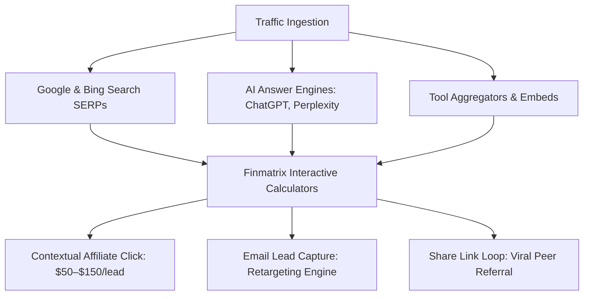

# Finmatrix: Organic Traffic & Conversion Growth Playbook

> **Target Site:** [https://finmatrix.cloud](https://finmatrix.cloud)  
> **Business Model:** High-Utility Financial Calculator Suite (No Blog Writing Required)  
> **Revenue Engines:** Contextual Affiliate Offers (Impact, CJ, FlexOffers) + Display Ads (Google AdSense) + Email Leads

---

## Executive Summary

Finmatrix does not require writing weekly blog articles. Calculator websites grow through **Utility SEO** (ranking for calculation intent), **AI Engine Citations (GEO)**, **Tool Directory Backlinks**, and **Contextual Conversion Loops**.

This playbook gives you a repeatable, step-by-step routine categorized into **Daily (15 min)**, **Weekly (45 min)**, and **Monthly (1 hr)** tasks to compound organic US visitors and maximize monetization revenue.



---

## Part 1: The 3 Conversion Engines of Finmatrix

### Engine 1: Contextual Affiliate Offers (Highest Revenue)
When a user calculates a result, they have **high purchase intent**:
- **Debt Elimination Calculator** $\rightarrow$ User realizes they have $12,000 in credit card debt $\rightarrow$ Contextual CTA: *"Save $2,400 in interest with a 0% Intro APR Balance Transfer Card"* (Pays **$60–$140** per approved card via Impact/CJ).
- **Mortgage Calculator** $\rightarrow$ User checks monthly payment on a $450k house $\rightarrow$ Contextual CTA: *"Compare Personalized Mortgage Quotes with Zero Credit Impact"* (Pays **$30–$80** per lead via LendingTree/Credible).
- **401(k) / IRA Calculator** $\rightarrow$ User sees compound growth $\rightarrow$ Contextual CTA: *"Open a Commission-Free Roth IRA with $0 Minimums"* (Pays **$50–$100** via M1 Finance/Robinhood/SoFi).

> **Action Item:** Replace placeholder URLs in [`config/affiliates.json`](file:///c:/Antigravity/finmatrix/config/affiliates.json) with your real affiliate links as you get approved by affiliate networks.

### Engine 2: Viral Share Links (Built-In Growth Loop)
Every calculator on Finmatrix has a `🔗 Share` button that generates a permanent shareable URL containing the user's exact parameters (e.g., `?currentSalary=100000&employeePct=10...`).
- When users share their calculation on Reddit (`r/FIRE`, `r/personalfinance`) or with a spouse, the recipient lands on the exact same solved scenario.
- This creates peer-to-peer referral traffic with zero ad spend.

### Engine 3: Email Capture for High-Value Financial Leads
Your newsletter endpoint (`subscribe.php`) is ready. Offer a free digital download:
- Lead Magnet: *"2026 Personal Finance Cheat Sheet & Debt Snowball Tracker (Excel/Sheets)"*.
- Place the email box directly below the calculator results card.

---

## Part 2: Step-by-Step Daily, Weekly & Monthly Routine

```
┌────────────────────────────────────────────────────────────────────────┐
│                        FINMATRIX GROWTH TIMETABLE                      │
├────────────────────────────────┬───────────────────────────────────────┤
│ Frequency                      │ Core Objective                        │
├────────────────────────────────┼───────────────────────────────────────┤
│ Daily (15 Minutes)             │ Community Answering & Link Seeds      │
│ Weekly (45 Minutes)            │ GSC Keyword Mining & Directory Drops  │
│ Monthly (1 Hour)               │ Affiliate Optimization & Conversion   │
└────────────────────────────────┴───────────────────────────────────────┘
```

---

### Phase A: The Daily 15-Minute Routine (Community Link Building)

Search algorithms reward sites that real people discuss and link to. Spend 15 minutes each weekday answering financial questions with Finmatrix calculations.

#### 1. Monitor 3 Target Subreddits (10 mins)
Open these subreddits daily:
- `r/personalfinance` (18M+ members)
- `r/FinancialPlanning` (3M+ members)
- `r/StudentLoans` or `r/realestateinvesting`

#### 2. Find Questions Requiring Exact Math
Look for posts asking:
- *"How much will I have if I max out my 401(k) with a 50% match?"*
- *"Should I pay off my 6.5% auto loan or invest?"*
- *"Is it worth refinancing from 7.2% to 5.75% with $4,000 closing costs?"*

#### 3. The 3-Step "High-Value Answer" Template (5 mins)
Never drop a raw link without providing value. Use this exact structure:

> **Step 1:** Give them the exact math answer in your comment:  
> *"At a $95,000 salary with a 50% match up to 6%, your employer contributes $2,850/yr in free money. Over 20 years at a 7% market return, that employer match alone compounds into roughly $116,800."*
>
> **Step 2:** Explain the rule-of-thumb takeaway:  
> *"Because matching contributions are an immediate 50% risk-free return, you should capture 100% of the match before putting extra cash into other accounts."*
>
> **Step 3:** Cite the interactive tool:  
> *"You can simulate your exact salary raises and retirement timeline on this free tool: `https://finmatrix.cloud/calculators/401k-calculator.html`"*

---

### Phase B: The Weekly 45-Minute Routine (SEO & Directory Expansion)

Dedicate one day per week (e.g., Saturday morning) to analyze your search data and submit to 2 tool directories.

#### Step 1: Google Search Console Performance Audit (15 mins)
1. Open [Google Search Console](https://search.google.com/search-console) $\rightarrow$ Click **Performance** on the left.
2. Check the box for **Average CTR** and **Average Position**.
3. Scroll down to the **Queries** table:
   - Identify queries in **Positions 8 to 20** (Page 2). These are your "Low-Hanging Fruit" keywords.
   - Example: If you rank #14 for *"auto loan calculator with trade in equity"*, look at the meta description and heading of [`calculators/auto-loan-calculator.html`](file:///c:/Antigravity/finmatrix/calculators/auto-loan-calculator.html) to make sure that exact phrase appears prominently.
4. If a page has high impressions but low CTR (<2%), make the title tag more actionable (e.g., add *"Free"*, *"Instant"*, or *"Updated for 2026"*).

#### Step 2: Submit to 2 New Free Tool Aggregators (20 mins)
Submit Finmatrix to curated web directories. Each submission creates a permanent backlink that boosts domain trust:

- **Week 1:** [Product Hunt](https://www.producthunt.com/) *(Use the guide from our previous step)*.
- **Week 2:** [AlternativeTo](https://alternativeto.net/) *(Already submitted! Check your listing approval)*.
- **Week 3:** [Toolify.ai](https://www.toolify.ai/) & [There's An AI For That](https://theresanaiforthat.com/).
- **Week 4:** [BetaList](https://betalist.com/) & [SideProjectors](https://www.sideprojectors.com/).
- **Week 5:** [Indie Hackers](https://www.indiehackers.com/) Product Directory.
- **Week 6:** [GitHub Awesome Lists](https://github.com/topics/personal-finance) (Submit pull request to `awesome-calculators` or `awesome-personal-finance`).

#### Step 3: Embed Widget Outreach (10 mins)
Reach out to 2 financial bloggers, debt counselors, or real estate creators:
> *"Hi [Name], I noticed your guide on debt payoff strategies. We built a free, responsive Debt Avalanche vs. Snowball embed widget with 0 ads and 0 tracking that your readers can use directly on your site. You can embed it in seconds: `https://finmatrix.cloud/embed/debt-payoff/`. Let me know if you'd like a custom version for your readers!"*

---

### Phase C: The Monthly 1-Hour Routine (Monetization & Conversion)

Once per month, review your conversion metrics and revenue channels.

#### 1. Affiliate Network Signups & Placements (30 mins)
Sign up for these major affiliate networks that accept personal finance tool websites:
1. **[Impact.com](https://impact.com/):** Host of SoFi, M1 Finance, Marcus by Goldman Sachs, Ally Bank, TurboTax.
2. **[CJ Affiliate (Commission Junction)](https://www.cj.com/):** LendingTree, Quicken, Experian, Credit Karma.
3. **[FlexOffers](https://www.flexoffers.com/):** Hundreds of high-yield savings (HYSA), balance transfer credit cards, and auto refi programs.

Once approved:
- Open [`config/affiliates.json`](file:///c:/Antigravity/finmatrix/config/affiliates.json).
- Paste your unique tracking link into the respective `url` fields.
- Re-deploy. The affiliate cards on all calculator pages will automatically update with your live tracking links.

#### 2. Test Conversion CTR in Google Analytics 4 (15 mins)
- Open GA4 $\rightarrow$ Go to **Events** $\rightarrow$ Look for `affiliate_click` and `share_link_click` (automatically tracked by [`js/analytics.js`](file:///c:/Antigravity/finmatrix/js/analytics.js)).
- See which calculator generates the most affiliate clicks:
  - If the Paycheck calculator gets 80% of clicks, optimize the CTA copy on that specific tool to boost conversion rates.

#### 3. Display Ads Milestone (15 mins)
- **At 500 Daily Visits:** Apply for **Google AdSense**. Paste your AdSense Publisher ID in `index.html` and the pre-styled ad slots (`#finmatrix-ad-slot`) across calculator pages.
- **At 10,000 Monthly Visits:** Apply for **Mediavine Journey** or **Monumetric** (these pay 3x–5x higher RPMs than basic AdSense, typically **$15–$30 per 1,000 pageviews** in US personal finance).

---

## Part 3: High-Converting Copy Formula for Financial Calculators

When visitors use a financial calculator, they are looking for **reassurance, clarity, and next steps**. Follow this 4-part framework on every calculator results section:

```
┌────────────────────────────────────────────────────────────────────────┐
│ 1. THE BIG RESULT: Clear bold number with timeline and total interest. │
│ 2. THE RULE OF THUMB: 1 sentence takeaway ("Pay off 22% debt first"). │
│ 3. THE NEXT ACTION: Contextual recommendation ("Switch to a 0% APR").  │
│ 4. THE TRUST CITATION: Official source link (IRS.gov, Federal Reserve).│
└────────────────────────────────────────────────────────────────────────┘
```

---

## Part 4: 90-Day Milestones & Growth Roadmap

| Milestone | Target Timeline | Expected Metric | Key Focus Action |
| :--- | :---: | :---: | :--- |
| **Stage 1: Indexation** | Days 1 – 15 | 36+ Indexed URLs | Verify Google Search Console & Bing sitemaps. |
| **Stage 2: Discovery** | Days 15 – 45 | 500+ Weekly Impressions | Reddit value drops & directory listings live. |
| **Stage 3: First Clicks** | Days 45 – 90 | 50–100 Daily US Visits | GSC keyword mining for position 8–20 keywords. |
| **Stage 4: First Revenue**| Months 3 – 5 | $200–$500/month | Live affiliate links in `config/affiliates.json`. |
| **Stage 5: Scaling** | Months 6 – 12 | 1,000+ Daily Visits | Ad network approval (Mediavine Journey / Ezoic). |

---

## Downloadable Guide File Reference
This complete playbook is saved directly in your Finmatrix project directory:
- 📄 **File Path:** [`c:\Antigravity\finmatrix\GROWTH_ROUTINE.md`](file:///c:/Antigravity/finmatrix/GROWTH_ROUTINE.md)
- You can open, read, edit, or print this document anytime.
