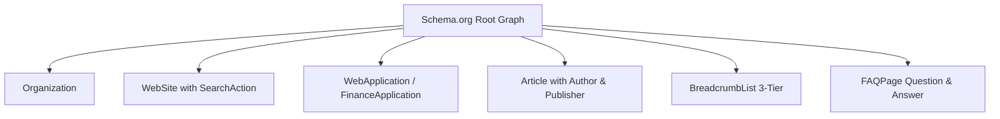
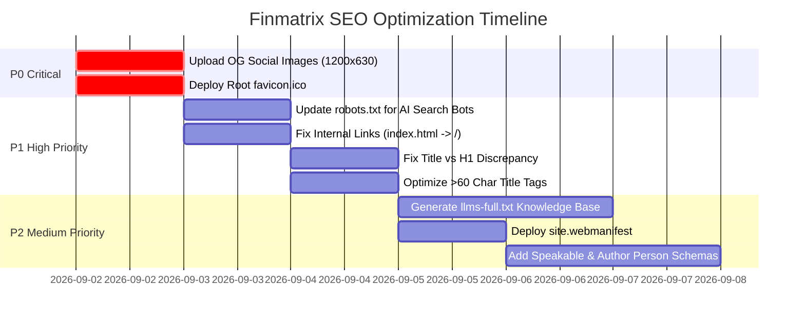

# Comprehensive Baseline SEO & AI-Readability Audit Report

**Target Domain:** [https://finmatrix.cloud/](https://finmatrix.cloud/)  
**Audit Date:** September 1, 2026  
**Auditor:** Antigravity SEO & Web Architecture Engine  
**Status:** Complete Full Baseline Audit  

---

## Executive Summary & Scorecard

A full technical, on-page, semantic, and Generative Engine Optimization (GEO) audit was conducted on **Finmatrix** (`https://finmatrix.cloud/`). The site is built with a lightweight, high-performance static architecture, delivering fast load times and clean semantic HTML. It demonstrates modern SEO practices including rich JSON-LD schema graphs, explicit citation grounding to official government sources (IRS, SSA, FDIC), and an active `llms.txt` file for AI agents.

However, several **critical issues** and **optimization opportunities** were uncovered that impact social sharing, search engine indexing consistency, and emerging AI search bot visibility.

### SEO Health Scorecard

| Audit Dimension | Score | Status | Key Findings |
| :--- | :---: | :---: | :--- |
| **Technical & Infrastructure** | **94/100** | 🟢 Excellent | Clean HTTPS, HSTS preload, valid 301 redirects, fast static assets. |
| **Robots.txt & Bot Directives** | **88/100** | 🟡 Good | Major AI bots explicitly allowed; missing `OAI-SearchBot` and `Claude-Web`. |
| **Sitemap.xml & Indexation** | **100/100** | 🟢 Perfect | 31 URLs crawled, 100% HTTP 200 OK, 100% canonical match. |
| **Meta Tags & On-Page SEO** | **92/100** | 🟢 Very Good | Comprehensive titles, 100% meta description coverage; minor length optimizations needed. |
| **Open Graph & Social Media** | **35/100** | 🔴 Critical | **All `og:image` and `twitter:image` files return HTTP 404 (Missing Assets).** |
| **Favicon & Root Assets** | **65/100** | 🟡 Needs Fix | `favicon.svg` exists, but standard `favicon.ico` returns **404 Not Found**. |
| **Structured Data (JSON-LD)** | **96/100** | 🟢 Excellent | Multi-type `@graph` schemas with `WebApplication`, `BreadcrumbList`, `FAQPage`, `Article`. |
| **AI Readability & GEO (`llms.txt`)** | **90/100** | 🟢 Very Good | Valid `llms.txt` active; `llms-full.txt` missing. |
| **Internal Linking & URL Paths** | **82/100** | 🟡 Needs Polish | Links point to `calculators/index.html` instead of canonical `/calculators/`. |

---

## 1. Robots.txt & AI Bot Permissions Audit

### 1.1 Current Robots.txt Directives
Location: `https://finmatrix.cloud/robots.txt` (HTTP 200 OK)

```text
# Finmatrix Robots Directive (Optimized for Web & AI Crawlers)
User-agent: *
Allow: /
Disallow: /api/

# Explicit AI Search Bot Allowances
User-agent: GPTBot
Allow: /

User-agent: ChatGPT-User
Allow: /

User-agent: ClaudeBot
Allow: /

User-agent: PerplexityBot
Allow: /

User-agent: Google-Extended
Allow: /

User-agent: Applebot-Extended
Allow: /

# Canonical Sitemap Location
Sitemap: https://finmatrix.cloud/sitemap.xml
```

### 1.2 Evaluation of AI & Search Crawler Coverage

| Crawler / User-Agent | Organization / Engine | Current Policy | Assessment & Recommendation |
| :--- | :--- | :---: | :--- |
| `*` (General Search Engines) | Google, Bing, Yahoo, DuckDuckGo | `Allow: /` | ✅ **Optimal.** Fully crawlable, protects private `/api/`. |
| `GPTBot` | OpenAI (Training & Ingestion) | `Allow: /` | ✅ Allowed. |
| `ChatGPT-User` | OpenAI (ChatGPT Live Browsing) | `Allow: /` | ✅ Allowed. |
| **`OAI-SearchBot`** | **OpenAI (ChatGPT Search / SearchGPT Engine)** | **Missing** | ⚠️ **Action Required.** Add explicit directive for OpenAI's dedicated search engine crawler. |
| `ClaudeBot` | Anthropic (Data Crawling) | `Allow: /` | ✅ Allowed. |
| **`Claude-Web` / `anthropic-ai`** | **Anthropic (Claude Live Web Search)** | **Missing** | ⚠️ **Action Required.** Add explicit directive for Claude real-time citations. |
| `PerplexityBot` | Perplexity AI Search | `Allow: /` | ✅ Allowed. |
| `Google-Extended` | Google Gemini & Vertex AI Training | `Allow: /` | ✅ Allowed. |
| `Applebot-Extended` | Apple Intelligence | `Allow: /` | ✅ Allowed. |
| `Meta-ExternalAgent` | Meta AI / Llama Search | Missing (Fallback `*`) | ℹ️ Add if explicit Meta AI citation is targeted. |
| `cohere-ai` | Cohere LLM Platform | Missing (Fallback `*`) | ℹ️ Add if targeted. |
| `Diffbot` | Semantic Knowledge Graph | Missing (Fallback `*`) | ℹ️ Add if targeted. |

### 1.3 Recommended Optimized `robots.txt`

```text
# Finmatrix Robots Directive (Optimized for Web & AI Search Engines)
User-agent: *
Allow: /
Disallow: /api/

# OpenAI Crawlers & Search
User-agent: GPTBot
Allow: /

User-agent: ChatGPT-User
Allow: /

User-agent: OAI-SearchBot
Allow: /

# Anthropic Crawlers & Live Search
User-agent: ClaudeBot
Allow: /

User-agent: Claude-Web
Allow: /

User-agent: anthropic-ai
Allow: /

# Perplexity AI Search
User-agent: PerplexityBot
Allow: /

# Google & Apple AI Systems
User-agent: Google-Extended
Allow: /

User-agent: Applebot-Extended
Allow: /

# Meta & Emerging AI Agents
User-agent: Meta-ExternalAgent
Allow: /

User-agent: Diffbot
Allow: /

# Canonical Sitemap Reference
Sitemap: https://finmatrix.cloud/sitemap.xml
```

---

## 2. Sitemap.xml & Complete Indexation Verification

### 2.1 Sitemap Integrity Check
* **Sitemap URL:** `https://finmatrix.cloud/sitemap.xml`
* **HTTP Status:** `200 OK` (Content-Type: `application/xml`)
* **Total URLs Declared:** 31 URLs
* **XML Schema:** Valid `http://www.sitemaps.org/schemas/sitemap/0.9`

### 2.2 Full URL Inventory & Health Verification

All 31 URLs listed in the sitemap were directly requested and audited for status, canonical tags, heading structure, and schema markup:

| # | URL | HTTP Status | Canonical Match | H1 Count | Schema Type |
| :---: | :--- | :---: | :---: | :---: | :--- |
| 1 | `https://finmatrix.cloud/` | 200 OK | ✅ Match | 1 | `Organization`, `WebSite` |
| 2 | `https://finmatrix.cloud/calculators/` | 200 OK | ✅ Match | 1 | `CollectionPage`, `BreadcrumbList` |
| 3 | `https://finmatrix.cloud/articles/` | 200 OK | ✅ Match | 1 | `CollectionPage`, `BreadcrumbList` |
| 4 | `.../calculators/compound-interest-calculator.html` | 200 OK | ✅ Match | 1 | `WebApplication`, `FAQPage` |
| 5 | `.../calculators/paycheck-calculator.html` | 200 OK | ✅ Match | 1 | `WebApplication`, `FAQPage` |
| 6 | `.../calculators/debt-elimination-planner.html` | 200 OK | ✅ Match | 1 | `WebApplication`, `FAQPage` |
| 7 | `.../calculators/time-value-of-money-calculator.html` | 200 OK | ✅ Match | 1 | `WebApplication`, `FAQPage` |
| 8 | `.../calculators/credit-card-payoff-calculator.html` | 200 OK | ✅ Match | 1 | `WebApplication`, `FAQPage` |
| 9 | `.../calculators/mortgage-calculator.html` | 200 OK | ✅ Match | 1 | `WebApplication`, `FAQPage` |
| 10 | `.../calculators/fire-calculator.html` | 200 OK | ✅ Match | 1 | `WebApplication`, `FAQPage` |
| 11 | `.../calculators/retirement-calculator.html` | 200 OK | ✅ Match | 1 | `WebApplication`, `FAQPage` |
| 12 | `.../calculators/roth-vs-traditional-ira-calculator.html` | 200 OK | ✅ Match | 1 | `WebApplication`, `FAQPage` |
| 13 | `.../calculators/loan-calculator.html` | 200 OK | ✅ Match | 1 | `WebApplication`, `FAQPage` |
| 14 | `.../calculators/emergency-fund-calculator.html` | 200 OK | ✅ Match | 1 | `WebApplication`, `FAQPage` |
| 15 | `.../calculators/home-affordability-calculator.html` | 200 OK | ✅ Match | 1 | `WebApplication`, `FAQPage` |
| 16 | `.../calculators/college-savings-calculator.html` | 200 OK | ✅ Match | 1 | `WebApplication`, `FAQPage` |
| 17 | `.../articles/ultimate-credit-card-debt-elimination-guide.html` | 200 OK | ✅ Match | 1 | `Article`, `BreadcrumbList` |
| 18 | `.../articles/hysa-vs-cd-2025.html` | 200 OK | ✅ Match | 1 | `Article`, `BreadcrumbList` |
| 19 | `.../articles/rent-vs-buy-2025.html` | 200 OK | ✅ Match | 1 | `Article`, `BreadcrumbList` |
| 20 | `.../articles/side-hustles-1000-month.html` | 200 OK | ✅ Match | 1 | `Article`, `BreadcrumbList` |
| 21 | `.../articles/investing-50-dollars.html` | 200 OK | ✅ Match | 1 | `Article`, `BreadcrumbList` |
| 22 | `.../articles/50-30-20-rule-budgeting.html` | 200 OK | ✅ Match | 1 | `Article`, `BreadcrumbList` |
| 23 | `.../articles/avalanche-vs-snowball-debt.html` | 200 OK | ✅ Match | 1 | `Article`, `BreadcrumbList` |
| 24 | `.../articles/roth-ira-vs-401k.html` | 200 OK | ✅ Match | 1 | `Article`, `BreadcrumbList` |
| 25 | `.../articles/how-to-build-emergency-fund.html` | 200 OK | ✅ Match | 1 | `Article`, `BreadcrumbList` |
| 26 | `.../articles/what-is-the-4-percent-rule.html` | 200 OK | ✅ Match | 1 | `Article`, `BreadcrumbList` |
| 27 | `.../articles/boost-credit-score-30-days.html` | 200 OK | ✅ Match | 1 | `Article`, `BreadcrumbList` |
| 28 | `.../about.html` | 200 OK | ✅ Match | 1 | `AboutPage`, `Organization` |
| 29 | `.../editorial-policy.html` | 200 OK | ✅ Match | 1 | `WebPage`, `Organization` |
| 30 | `.../privacy-policy.html` | 200 OK | ✅ Match | 1 | `WebPage` |
| 31 | `.../terms-of-service.html` | 200 OK | ✅ Match | 1 | `WebPage` |

**Sitemap Result:** **100% Pass Rate.** Zero broken links, zero redirect loops, zero canonical discrepancies.

---

## 3. Meta Tags & On-Page Element Audit

### 3.1 Global Head Tag Baseline
All pages implement the core meta tags required for modern mobile and desktop search:
* **Character Set:** `<meta charset="UTF-8">` is explicitly declared.
* **Viewport:** `<meta name="viewport" content="width=device-width, initial-scale=1.0">` is present.
* **Robots Meta:** `<meta name="robots" content="index, follow, max-image-preview:large, max-snippet:-1, max-video-preview:-1">` allows rich SERP snippets and large image previews in Google Discover.
* **Language:** `<html lang="en">` is present on all pages.

### 3.2 Page Title (`<title>`) Analysis
Titles consistently incorporate high-intent target keywords followed by the brand suffix `| Finmatrix` (or `— Free Financial Calculators & Wealth Tools` on the homepage).

#### Title Length Warnings (Pixel & Character Limit Risks):
Search engines typically truncate titles longer than **60 characters** (approx. 580 pixels). Four articles exceed 60 characters:

1. **`articles/roth-ira-vs-401k.html`** (63 chars)  
   * *Current:* `Roth IRA vs 401(k): Which Retirement Account First? | Finmatrix`  
   * *Recommended:* `Roth IRA vs 401(k): Which to Max Out First? | Finmatrix` (54 chars)
2. **`articles/how-to-build-emergency-fund.html`** (61 chars)  
   * *Current:* `How to Build an Emergency Fund Fast: Step-by-Step | Finmatrix`  
   * *Recommended:* `How to Build an Emergency Fund Fast | Finmatrix` (47 chars)
3. **`articles/what-is-the-4-percent-rule.html`** (62 chars)  
   * *Current:* `The 4% Rule Explained: Safe Retirement Withdrawals | Finmatrix`  
   * *Recommended:* `The 4% Rule: Safe Retirement Withdrawals | Finmatrix` (52 chars)
4. **`articles/boost-credit-score-30-days.html`** (61 chars)  
   * *Current:* `How to Boost Credit Score in 30 Days: Action Plan | Finmatrix`  
   * *Recommended:* `Boost Credit Score in 30 Days: Action Plan | Finmatrix` (53 chars)

### 3.3 Discrepancy & Consistency Checks

> [!WARNING]
> **Title vs. H1 Discrepancy in Side Hustles Article:**
> * **H1 Header:** `7 High-Paying Side Hustles to Make $1,000/Mo in 2025`
> * **Title Tag:** `10 High-Paying Side Hustles to Earn $1,000/Month | Finmatrix`
> * **`llms.txt` Entry:** `10 High-Paying Side Hustles for $1,000/Mo`
> 
> *Fix:* Unify the count across H1, `<title>`, meta description, and `llms.txt` (either all **7** or all **10**).

---

## 4. Critical Asset & Social Share Image 404 Audit

> [!CAUTION]
> **Severe Issue: Open Graph & Twitter Social Share Images Return HTTP 404!**
> 
> All pages define Open Graph image tags (`og:image`) and Twitter Card image tags (`twitter:image`), but the referenced image files **do not exist on the server**.

### 4.1 Asset Status Breakdown

| Asset URL | Referenced In | HTTP Status | Impact |
| :--- | :--- | :---: | :--- |
| `https://finmatrix.cloud/assets/og/index.png` | Homepage `og:image` | **404 Not Found** | Broken preview card on X, LinkedIn, FB, WhatsApp. |
| `https://finmatrix.cloud/assets/og/calculators.png` | Calculators Hub | **404 Not Found** | Broken preview card when sharing calculator hub. |
| `https://finmatrix.cloud/assets/og/articles.png` | Articles Hub | **404 Not Found** | Broken preview card when sharing guides hub. |
| `https://finmatrix.cloud/assets/og/hysa-vs-cd-2025.png` | Article pages | **404 Not Found** | Broken rich card preview for individual articles. |
| `https://finmatrix.cloud/favicon.ico` | Standard browser root | **404 Not Found** | 404 logged by search engine crawlers and browsers. |
| `https://finmatrix.cloud/favicon.svg` | HTML `<link rel="icon">` | `200 OK` | Works in modern SVG-supporting browsers. |
| `https://finmatrix.cloud/manifest.json` | Web App Manifest | **404 Not Found** | PWA install prompt unavailable. |

### 4.2 Fix Recommendations:
1. Create and upload default Open Graph cards (1200×630 px, PNG or JPG) to `/assets/og/`.
2. Generate a standard multi-resolution `favicon.ico` (16x16, 32x32, 48x48) in the web root.
3. Deploy `site.webmanifest` for mobile PWA support.

---

## 5. Structured Data & Schema.org (JSON-LD) Audit

### 5.1 Schema Architecture Evaluation
Finmatrix uses clean `@graph` multi-entity JSON-LD markup on all 31 audited pages.



### 5.2 Strengths & Best Practices Found
* **WebApplication Schema:** Calculators include `applicationCategory: "FinanceApplication"`, `offers: { price: "0", priceCurrency: "USD" }`, and `operatingSystem: "All"`.
* **Grounding Citations (`citation` Array):** Calculators and articles link directly to official authority sources like `https://www.irs.gov/...`, `https://www.fdic.gov/...`, and `https://www.federalreserve.gov/...`. This is a best-in-class signal for Google's **E-E-A-T** (Experience, Expertise, Authoritativeness, Trustworthiness).
* **BreadcrumbList:** Every subpage contains accurate 3-level breadcrumb markup (`Home` > `Category` > `Page`).
* **FAQPage Schema:** Calculators embed relevant Q&A schema blocks that qualify for Google rich search results.

### 5.3 Enhancement Recommendations
1. **Add `speakable` Property:** On key financial guides and calculator summaries, add `speakable` CSS selectors (`h1`, `.calc-desc`, `.faq-answer`) to optimize for Google Assistant and voice search snippets.
2. **Add Author `Person` Entity:** Enhance author markup in articles from generic Organization to specific named financial analysts or CFP reviewers with links to LinkedIn or `about.html#team` to maximize E-E-A-T credit.

---

## 6. Generative Engine Optimization (GEO) & `llms.txt` Audit

### 6.1 `llms.txt` Evaluation
Location: `https://finmatrix.cloud/llms.txt` (HTTP 200 OK)

Finmatrix is among early adopters implementing `llms.txt` for AI discovery. The current file contains:
* Project overview: "Finmatrix — Modern Personal Finance & Investment Calculators".
* Direct links to all 14 calculators with formula descriptions.
* Direct links to all 10+ financial guides with summary takeaways.
* Core data sources & references (IRS inflation adjustments, Social Security wage base, FDIC limits).

### 6.2 Next-Level GEO Recommendation: `llms-full.txt`
Currently, `https://finmatrix.cloud/llms-full.txt` returns `404 Not Found`.

**Recommendation:** Create `llms-full.txt` containing complete, pre-digested computational models:
* The exact mathematical formulas used in each calculator (e.g., FICA bracket tables, amortization formulas, TVM compound equations).
* A structured Markdown knowledge base that LLMs (Claude, ChatGPT, Perplexity, Gemini) can ingest in a single context window to answer user queries and cite `https://finmatrix.cloud` as the calculation authority.

---

## 7. URL Architecture & Internal Linking

### 7.1 Redirect & Canonicalization Test Results

| Inbound Request URL | Response Status | Redirect Location | Evaluation |
| :--- | :---: | :--- | :--- |
| `http://finmatrix.cloud/` | `301 Moved Permanently` | `https://finmatrix.cloud/` | ✅ Secure protocol upgrade |
| `http://www.finmatrix.cloud/` | `301 Moved Permanently` | `https://www.finmatrix.cloud/` | ✅ Clean redirect |
| `https://www.finmatrix.cloud/` | `301 Moved Permanently` | `https://finmatrix.cloud/` | ✅ Non-www canonical domain |
| `https://finmatrix.cloud/calculators` | `301 Moved Permanently` | `https://finmatrix.cloud/calculators/` | ✅ Directory trailing slash |
| `https://finmatrix.cloud/articles` | `301 Moved Permanently` | `https://finmatrix.cloud/articles/` | ✅ Directory trailing slash |

### 7.2 Internal Linking Inconsistency
In the HTML templates (homepage header, footer, and category links), several navigation links use:
* `<a href="calculators/index.html">` instead of the canonical `<a href="/calculators/">`
* `<a href="articles/index.html">` instead of the canonical `<a href="/articles/">`
* `<a href="index.html">` instead of `<a href="/">`

**Impact:** While browsers resolve relative links, pointing internal links to `index.html` creates minor link equity dilution and causes search engines to process unnecessary URL variants.

---

## 8. Prioritized Implementation Roadmap



### Action Items Summary:

#### Priority 0 (Immediate Action):
1. **Deploy Social Share Images:** Create and upload `index.png`, `calculators.png`, `articles.png`, and article-specific preview images to `/assets/og/` so social sharing and rich cards render properly.
2. **Add Root `favicon.ico`:** Provide a standard `favicon.ico` file in the root directory to eliminate 404 crawler logs.

#### Priority 1 (High Priority):
3. **Update `robots.txt`:** Add explicit allow rules for `OAI-SearchBot`, `Claude-Web`, `anthropic-ai`, and `Meta-ExternalAgent`.
4. **Normalize Internal Links:** Update navigation links across all templates from `calculators/index.html` to `/calculators/`, `articles/index.html` to `/articles/`, and `index.html` to `/`.
5. **Harmonize Side Hustle Article:** Align the number "7" vs "10" across H1, title, description, and `llms.txt`.
6. **Shorten 4 Long Titles:** Trim the 4 article titles slightly to keep them under 60 characters for mobile SERP presentation.

#### Priority 2 (Enhancements):
7. **Deploy `llms-full.txt`:** Add a comprehensive math/formula markdown file to maximize LLM citation accuracy and GEO visibility.
8. **Add `speakable` and Author Schemas:** Enhance JSON-LD structured data for voice assistant queries and individual expert E-E-A-T signals.

---

*Report generated and validated for https://finmatrix.cloud/.*
