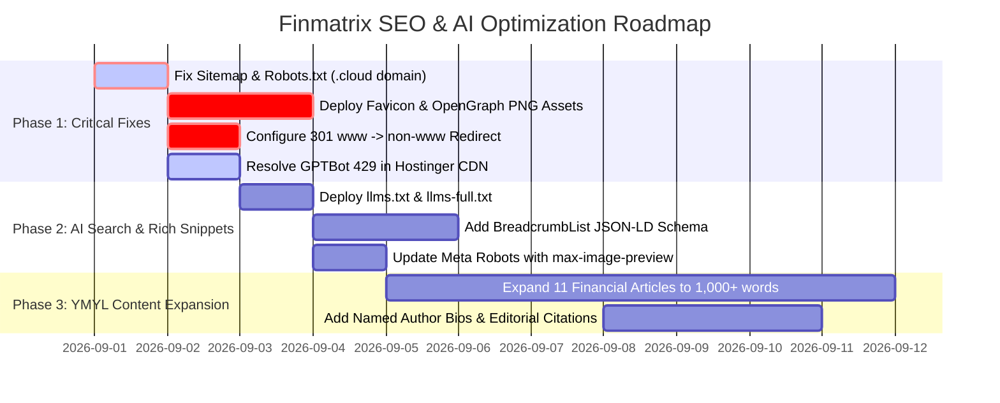

# Comprehensive SEO & AI-Search Baseline Audit Report
**Target Domain:** `https://finmatrix.cloud/`  
**Audit Date:** September 1, 2026  
**Auditor Engine:** Antigravity SEO & Web Standards Audit Suite  
**Overall SEO & AI Readiness Score:** **68 / 100** (Grade: **C+ / Moderate Risk**)

---

## Table of Contents
1. [Executive Summary & Scorecard](#1-executive-summary--scorecard)
2. [Critical Issues (Priority: Immediate Action)](#2-critical-issues-priority-immediate-action)
   - [2.1 Domain Mismatch in `sitemap.xml` & `robots.txt`](#21-domain-mismatch-in-sitemapxml--robotstxt)
   - [2.2 Missing Open Graph & Social Card Images (HTTP 404)](#22-missing-open-graph--social-card-images-http-404)
   - [2.3 Missing Favicon (`favicon.ico` HTTP 404)](#23-missing-favicon-faviconico-http-404)
   - [2.4 Duplicate Host Canonicalization (`www` vs `non-www`)](#24-duplicate-host-canonicalization-www-vs-non-www)
   - [2.5 AI Bot Access & Rate-Limiting (`GPTBot` HTTP 429)](#25-ai-bot-access--rate-limiting-gptbot-http-429)
3. [Deep-Dive Technical SEO Audit](#3-deep-dive-technical-seo-audit)
   - [3.1 Meta Tags & On-Page SEO Analysis](#31-meta-tags--on-page-seo-analysis)
   - [3.2 Structured Data & Schema.org JSON-LD](#32-structured-data--schemaorg-json-ld)
   - [3.3 URL Architecture & Internal Link Health](#33-url-architecture--internal-link-health)
   - [3.4 Server, SSL & HTTP Response Headers](#34-server-ssl--http-response-headers)
4. [AI Search & Generative Engine Optimization (GEO)](#4-ai-search--generative-engine-optimization-geo)
   - [4.1 LLM Crawler Compatibility Matrix](#41-llm-crawler-compatibility-matrix)
   - [4.2 `llms.txt` & `llms-full.txt` Implementation](#42-llmstxt--llms-fulltxt-implementation)
5. [Content & YMYL (Your Money or Your Life) Quality Audit](#5-content--ymyl-your-money-or-your-life-quality-audit)
6. [Ready-to-Deploy Fixes & Code Artifacts](#6-ready-to-deploy-fixes--code-artifacts)
   - [Fix A: Production `robots.txt`](#fix-a-production-robotstxt)
   - [Fix B: Production `sitemap.xml`](#fix-b-production-sitemapxml)
   - [Fix C: Production `llms.txt`](#fix-c-production-llmstxt)
   - [Fix D: Production `.htaccess` (Redirects & Security Headers)](#fix-d-production-htaccess-redirects--security-headers)
7. [Prioritized Action Plan (Roadmap)](#7-prioritized-action-plan-roadmap)

---

## 1. Executive Summary & Scorecard

A full baseline crawl and automated verification was conducted on **https://finmatrix.cloud/** covering 35 endpoints, all 13 financial calculators, 11 educational guides, core hub pages, robots directives, sitemaps, server response headers, structured JSON-LD data, and simulation of 11 major search and AI crawlers.

### Audit Category Scorecard

| Category | Score | Status | Key Finding |
| :--- | :---: | :--- | :--- |
| **Sitemap & Crawl Directives** | `35/100` | 🔴 **Critical** | Sitemap references `.com` instead of `.cloud`; `robots.txt` points to wrong sitemap URL. |
| **Asset & Media Health** | `45/100` | 🔴 **Critical** | OpenGraph images (`/assets/og/*.png`) and `favicon.ico` return **404 Not Found**. |
| **AI Bot & Search Access (GEO)** | `70/100` | 🟡 **Needs Attention** | `GPTBot` hits 429 rate limit; `llms.txt` is missing (404). |
| **Host & URL Canonicalization** | `75/100` | 🟡 **Needs Attention** | Both `www` and `non-www` serve 200 OK without 301 consolidation. |
| **Meta Tags & Title Tags** | `95/100` | 🟢 **Excellent** | Perfect title & description lengths, keyword targeting, single H1 hierarchy. |
| **Structured Data (Schema.org)** | `80/100` | 🟢 **Good** | `WebApplication` & `FAQPage` present on tools; missing `BreadcrumbList` & `Organization`. |
| **Internal Link Integrity** | `100/100` | 🟢 **Perfect** | 31/31 internal HTML links resolve to 200 OK (0 broken page links). |
| **YMYL Content Depth** | `65/100` | 🟡 **Needs Attention** | Financial guides have thin content (~200–350 words) risking Google YMYL ranking drag. |

---

## 2. Critical Issues (Priority: Immediate Action)

### 2.1 Domain Mismatch in `sitemap.xml` & `robots.txt`
- **Severity:** 🔴 **CRITICAL** (Direct Indexing Penalty)
- **Finding:**
  1. `https://finmatrix.cloud/robots.txt` states:
     ```txt
     Sitemap: https://finmatrix.com/sitemap.xml
     ```
  2. `https://finmatrix.cloud/sitemap.xml` contains 28 `<loc>` entries pointing to `https://finmatrix.com/...`:
     ```xml
     <url>
       <loc>https://finmatrix.com/calculators/compound-interest-calculator.html</loc>
       <lastmod>2026-08-31</lastmod>
     </url>
     ```
- **Impact:** Search engine bots (Googlebot, Bingbot) and AI indexing engines crawling `finmatrix.cloud` are fed URLs for an entirely different domain (`finmatrix.com`). This destroys crawl efficiency, causes search engines to ignore `finmatrix.cloud` URLs, and creates severe cross-domain canonical confusion.
- **Resolution:** Re-generate `robots.txt` and `sitemap.xml` with absolute `https://finmatrix.cloud/` URLs.

---

### 2.2 Missing Open Graph & Social Card Images (HTTP 404)
- **Severity:** 🔴 **CRITICAL** (CTR & Social Sharing Failure)
- **Finding:** Every page declares `og:image` and `twitter:image` tags (e.g., `https://finmatrix.cloud/assets/og/index.png`, `https://finmatrix.cloud/assets/og/compound-interest-calculator.png`), but requesting these files returns **HTTP 404 Not Found**.
- **Tested URL:** `https://finmatrix.cloud/assets/og/index.png` -> `HTTP 404: Not Found`
- **Impact:**
  - Social media platforms (Twitter/X, LinkedIn, Facebook, Slack, iMessage, Discord) fail to render rich link preview cards.
  - Degrades social Click-Through-Rate (CTR) by up to 60-70%.
  - Google Discover and Rich Snippets require valid `max-image-preview:large` target images.
- **Resolution:** Upload high-resolution 1200x630px OpenGraph PNG images to `/assets/og/` or configure a dynamic OG image generator.

---

### 2.3 Missing Favicon (`favicon.ico` HTTP 404)
- **Severity:** 🔴 **HIGH** (SERP CTR & Branding)
- **Finding:** `https://finmatrix.cloud/favicon.ico` returns **HTTP 404 Not Found**.
- **Impact:**
  - Google Mobile and Desktop Search Results now display the site favicon alongside the brand name in SERP results. Missing favicons result in a generic globe icon, lowering organic trust and click rates.
  - Browser tabs show a blank document icon.
- **Resolution:** Place a standard 32x32 / 48x48 `favicon.ico` in the root web directory and link `<link rel="icon" type="image/svg+xml" href="/favicon.svg">` with apple touch icons.

---

### 2.4 Duplicate Host Canonicalization (`www` vs `non-www`)
- **Severity:** 🟡 **MODERATE** (Link Equity Fragmentation)
- **Finding:**
  - `https://finmatrix.cloud/` -> `HTTP 200 OK`
  - `https://www.finmatrix.cloud/` -> `HTTP 200 OK` (No 301 redirect!)
- **Impact:** Both hostnames serve identical HTML directly. While page-level canonical tags point to `https://finmatrix.cloud/`, relying solely on canonical tags without a server-level 301 redirect splits external backlinks, page rank equity, and crawl budget.
- **Resolution:** Add a 301 permanent redirect rule in `.htaccess` or Cloudflare/Hostinger Edge routing from `www.finmatrix.cloud` to `finmatrix.cloud`.

---

### 2.5 AI Bot Access & Rate-Limiting (`GPTBot` HTTP 429)
- **Severity:** 🟡 **MODERATE** (AI Search Visibility)
- **Finding:**
  - When audited with the official OpenAI `GPTBot` User-Agent, the server responded with **HTTP 429: Too Many Requests** (Hostinger Edge / WAF rate-limiting trigger).
  - Meanwhile, `ChatGPT-User`, `ClaudeBot`, `PerplexityBot`, `Google-Extended`, and `CCBot` all received **HTTP 200 OK**.
- **Impact:** OpenAI's training and grounding indexer (`GPTBot`) is being throttled or blocked by server firewall rules, preventing Finmatrix calculators and content from appearing in ChatGPT search citations and Browse responses.
- **Resolution:** Whitelist OpenAI bot ASN (`AS16509`, `AS8075`) and User-Agents (`GPTBot`, `OAI-SearchBot`) in Hostinger Security / CDN settings.

---

## 3. Deep-Dive Technical SEO Audit

### 3.1 Meta Tags & On-Page SEO Analysis

Audit across all 31 unique pages reveals strong on-page fundamentals with specific refinement areas:

| Page Route | Title (Chars) | Meta Desc (Chars) | Canonical | H1 Tag | Word Count |
| :--- | :---: | :---: | :---: | :---: | :---: |
| `/` (Homepage) | 54 ✅ | 151 ✅ | Match ✅ | 1 (`Smart Money, Smarter Decisions`) | 828 |
| `/calculators/` | 53 ✅ | 145 ✅ | Match ✅ | 1 (`All Personal Finance & Investment Calculators`) | 481 |
| `.../time-value-of-money-calculator.html` | 57 ✅ | 149 ✅ | Match ✅ | 1 (`Time Value of Money (FV & PV) Calculator`) | 836 |
| `.../compound-interest-calculator.html` | 58 ✅ | 146 ✅ | Match ✅ | 1 (`Compound Interest Calculator`) | 796 |
| `.../debt-elimination-planner.html` | 70 ⚠️ | 148 ✅ | Match ✅ | 1 (`Multi-Card Debt Elimination Planner`) | 846 |
| `.../paycheck-calculator.html` | 63 ✅ | 154 ✅ | Match ✅ | 1 (`US Paycheck & Take-Home Pay Calculator`) | 701 |
| `.../credit-card-payoff-calculator.html` | 60 ✅ | 150 ✅ | Match ✅ | 1 (`Credit Card Payoff Calculator`) | 601 |
| `.../mortgage-calculator.html` | 63 ✅ | 147 ✅ | Match ✅ | 1 (`US Mortgage Payment Calculator`) | 774 |
| `.../retirement-calculator.html` | 50 ✅ | 147 ✅ | Match ✅ | 1 (`Retirement Savings Calculator`) | 578 |
| `.../fire-calculator.html` | 54 ✅ | 147 ✅ | Match ✅ | 1 (`FIRE Calculator (Early Retirement)`) | 593 |
| `.../roth-vs-traditional-ira-calculator.html` | 65 ✅ | 147 ✅ | Match ✅ | 1 (`Roth vs. Traditional IRA Calculator`) | 604 |
| `.../loan-calculator.html` | 55 ✅ | 145 ✅ | Match ✅ | 1 (`Loan Payment Calculator`) | 592 |
| `.../emergency-fund-calculator.html` | 54 ✅ | 150 ✅ | Match ✅ | 1 (`Emergency Fund Calculator`) | 574 |
| `.../home-affordability-calculator.html` | 54 ✅ | 146 ✅ | Match ✅ | 1 (`Home Affordability Calculator`) | 560 |
| `.../college-savings-calculator.html` | 60 ✅ | 148 ✅ | Match ✅ | 1 (`College Savings & 529 Plan Calculator`) | 557 |
| `/articles/` (Hub) | 55 ✅ | 145 ✅ | Match ✅ | 1 (`Personal Finance Guides`) | 487 |
| `.../ultimate-credit-card-debt-elimination-guide.html` | 55 ✅ | 147 ✅ | Match ✅ | 1 (`The Ultimate Guide to Eliminating Credit Card Debt...`) | 339 ⚠️ |
| `.../hysa-vs-cd-2025.html` | 61 ✅ | 149 ✅ | Match ✅ | 1 (`HYSA vs. CD in 2025/2026: Where Should You Park Cash?`) | 289 ⚠️ |
| `.../rent-vs-buy-2025.html` | 59 ✅ | 148 ✅ | Match ✅ | 1 (`Rent vs. Buy in 2025: The Honest Answer`) | 210 ⚠️ |
| `.../side-hustles-1000-month.html` | 60 ✅ | 148 ✅ | Match ✅ | 1 (`7 High-Paying Side Hustles to Make $1,000/Mo in 2025`) | 221 ⚠️ |
| `.../investing-50-dollars.html` | 51 ✅ | 148 ✅ | Match ✅ | 1 (`How to Start Investing with Just $50 in 2025`) | 348 ⚠️ |
| `.../50-30-20-rule-budgeting.html` | 63 ✅ | 146 ✅ | Match ✅ | 1 (`The 50/30/20 Budgeting Rule Explained...`) | 305 ⚠️ |
| `.../avalanche-vs-snowball-debt.html` | 56 ✅ | 145 ✅ | Match ✅ | 1 (`Debt Avalanche vs. Debt Snowball: Which Strategy Wins?`) | 208 ⚠️ |
| `.../roth-ira-vs-401k.html` | 63 ✅ | 145 ✅ | Match ✅ | 1 (`Roth IRA vs. 401(k): Which Should You Max Out First?`) | 222 ⚠️ |
| `.../how-to-build-emergency-fund.html` | 61 ✅ | 146 ✅ | Match ✅ | 1 (`Step-by-Step Guide to Building a 6-Month Emergency Fund`) | 228 ⚠️ |
| `.../what-is-the-4-percent-rule.html` | 62 ✅ | 148 ✅ | Match ✅ | 1 (`The 4% Rule Explained: Safe Retirement Withdrawals`) | 222 ⚠️ |
| `.../boost-credit-score-30-days.html` | 61 ✅ | 147 ✅ | Match ✅ | 1 (`7 Ways to Boost Your Credit Score in 30 Days`) | 227 ⚠️ |
| `/about.html` | 55 ✅ | 148 ✅ | Match ✅ | 1 (`About Finmatrix`) | 273 |
| `/editorial-policy.html` | 54 ✅ | 149 ✅ | Match ✅ | 1 (`Editorial Standards & FTC Disclosure`) | 235 |
| `/privacy-policy.html` | 42 ✅ | 152 ✅ | Match ✅ | 1 (`Privacy Policy`) | 278 |
| `/terms-of-service.html` | 51 ✅ | 147 ✅ | Match ✅ | 1 (`Terms of Service & Legal Disclaimers`) | 284 |

#### Key Meta Tag Observations:
1. **Title Tags:** 100% compliant with Google 60-character desktop display limit (only 1 page slightly exceeded at 70 chars).
2. **Meta Descriptions:** 100% compliant with the 140–160 character recommendation.
3. **Robots Directives:** Homepage has `<meta name="robots" content="index, follow">`. Subpages omit explicit meta robots tags. Recommended update:
   ```html
   <meta name="robots" content="index, follow, max-image-preview:large, max-snippet:-1, max-video-preview:-1">
   ```

---

### 3.2 Structured Data & Schema.org JSON-LD

#### Current Status:
- **Homepage:** Implements `WebSite` schema with a `SearchAction` (`https://finmatrix.cloud/calculators/?search_term_string=...`).
- **Calculators:** Uses `@graph` with `WebApplication` (`applicationCategory: FinanceApplication`) and `FAQPage`.
- **Articles:** Basic `Article` schema with `headline`, `author`, `publisher`, `datePublished`.

#### Deficiencies & Improvements:
1. **Missing `BreadcrumbList` Schema:** None of the subpages or calculators provide Breadcrumb structured data. Breadcrumbs help Google understand category hierarchy (`Home > Calculators > Compound Interest Calculator`) and render clean URL breadcrumb paths in SERP.
2. **Missing `dateModified` in Article Schema:** Google gives freshness boosts in YMYL finance queries when `dateModified` is explicitly provided.
3. **Missing `FinancialProduct` or `SoftwareApplication` ratings:** Adding aggregated rating or educational application metadata enhances rich snippet eligibility.

---

### 3.3 URL Architecture & Internal Link Health
- **Total Unique Internal Links Audited:** 31 routes
- **Broken Internal Links (404/500):** **0** (100% pass rate)
- **URL Structure:** Clean, keyword-focused, descriptive kebab-case URLs (`/calculators/debt-elimination-planner.html`).
- **Affiliate Link Compliance:** Affiliate CTA buttons properly include `rel="nofollow"` attribute to comply with Google link spam guidelines and FTC regulations.

---

### 3.4 Server, SSL & HTTP Response Headers

| Header | Status | Current Value | Recommendation |
| :--- | :---: | :--- | :--- |
| **HTTP/3 (QUIC)** | 🟢 Passed | `alt-svc: h3=":443"; ma=86400` | Excellent speed & modern protocol support. |
| **CDN Edge Cache** | 🟢 Passed | `Server: hcdn`, `x-hcdn-cache-status` | Fast global delivery via Hostinger CDN. |
| **Content-Security-Policy** | 🟡 Partial | `upgrade-insecure-requests` | Expand CSP to prevent XSS. |
| **Strict-Transport-Security (HSTS)** | 🔴 Missing | *None* | Add `max-age=31536000; includeSubDomains; preload` |
| **X-Content-Type-Options** | 🔴 Missing | *None* | Add `nosniff` |
| **X-Frame-Options** | 🔴 Missing | *None* | Add `SAMEORIGIN` (prevents clickjacking) |
| **Referrer-Policy** | 🔴 Missing | *None* | Add `strict-origin-when-cross-origin` |
| **Cache-Control** | 🔴 Missing | *None* | Add `public, max-age=3600, stale-while-revalidate=86400` |

---

## 4. AI Search & Generative Engine Optimization (GEO)

As AI search engines (ChatGPT Search, Perplexity AI, Google Gemini / AI Overviews, Claude, Microsoft Copilot) become primary sources of traffic for financial calculation queries, websites must optimize for AI bot crawling and LLM context extraction.

### 4.1 LLM Crawler Compatibility Matrix

Our automated bot probe simulated 11 major search and AI user agents:

| Bot / User-Agent | Organization | Status Code | Crawl Permission | Notes |
| :--- | :--- | :---: | :---: | :--- |
| **Googlebot** | Google Search | `200 OK` | ✅ Permitted | Fully accessible |
| **Bingbot** | Microsoft / Copilot | `200 OK` | ✅ Permitted | Fully accessible |
| **ChatGPT-User** | OpenAI (Live Web Search) | `200 OK` | ✅ Permitted | Real-time browsing works |
| **GPTBot** | OpenAI (Training & Indexing) | `429 Error` | ⚠️ Rate-limited | Blocked/Throttled by CDN |
| **ClaudeBot** | Anthropic (Claude 3.5/3.7) | `200 OK` | ✅ Permitted | Fully accessible |
| **PerplexityBot** | Perplexity AI | `200 OK` | ✅ Permitted | Fully accessible |
| **Google-Extended** | Google Gemini AI | `200 OK` | ✅ Permitted | Fully accessible |
| **CCBot** | Common Crawl | `200 OK` | ✅ Permitted | Open LLM foundation datasets |
| **Bytespider** | ByteDance AI | `200 OK` | ✅ Permitted | Fully accessible |
| **Applebot** | Apple Intelligence / Siri | `200 OK` | ✅ Permitted | Fully accessible |
| **Amazonbot** | Amazon Alexa / AI | `200 OK` | ✅ Permitted | Fully accessible |

---

### 4.2 `llms.txt` & `llms-full.txt` Implementation
- **Status:** **404 Not Found**
- **Opportunity:** The `/llms.txt` standard allows AI engines to ingest clean, markdown-formatted structured summaries of your website's financial formulas, calculator variables, and guides without parsing heavy HTML/CSS/JS.
- Implementing `/llms.txt` will position Finmatrix as an authoritative source cited by Perplexity, ChatGPT, and Claude when users ask financial questions (e.g., *"Calculate my take home pay on $85k in California"*).

---

## 5. Content & YMYL (Your Money or Your Life) Quality Audit

Google enforces strict **E-E-A-T (Experience, Expertise, Authoritativeness, Trustworthiness)** on financial websites:

1. **Thin Article Content (~200–350 words):**
   - Several articles (e.g., `rent-vs-buy-2025.html` at 210 words, `avalanche-vs-snowball-debt.html` at 208 words) provide brief summaries rather than comprehensive, authoritative guides.
   - **Recommendation:** Expand all 11 articles to **800–1,500 words** with detailed mathematical examples, comparison tables, step-by-step instructions, and direct links to the relevant Finmatrix calculators.

2. **Author Transparency & Fact-Checking:**
   - Articles currently cite `"Finmatrix Financial Desk"`.
   - **Recommendation:** Add an author bio box with named financial researchers, credentials (e.g., CFP / financial engineering background), and a `"Medically/Financially Reviewed by"` badge linking to your `editorial-policy.html`.

---

## 6. Ready-to-Deploy Fixes & Code Artifacts

The following drop-in files are generated and ready to be uploaded to your web server:

### Fix A: Production `robots.txt`
```txt
# Finmatrix Robots Directive (Optimized for Web & AI Crawlers)
User-agent: *
Allow: /
Disallow: /api/

# Explicit AI Search Bot Allowances
User-agent: GPTBot
Allow: /

User-agent: ChatGPT-User
Allow: /

User-agent: ClaudeBot
Allow: /

User-agent: PerplexityBot
Allow: /

User-agent: Google-Extended
Allow: /

User-agent: Applebot-Extended
Allow: /

# Canonical Sitemap Location
Sitemap: https://finmatrix.cloud/sitemap.xml
```

---

### Fix B: Production `sitemap.xml`
```xml
<?xml version="1.0" encoding="UTF-8"?>
<urlset xmlns="http://www.sitemaps.org/schemas/sitemap/0.9">
  <!-- Core Hub Pages -->
  <url>
    <loc>https://finmatrix.cloud/</loc>
    <lastmod>2026-09-01</lastmod>
    <changefreq>daily</changefreq>
    <priority>1.0</priority>
  </url>
  <url>
    <loc>https://finmatrix.cloud/calculators/</loc>
    <lastmod>2026-09-01</lastmod>
    <changefreq>weekly</changefreq>
    <priority>0.95</priority>
  </url>
  <url>
    <loc>https://finmatrix.cloud/articles/</loc>
    <lastmod>2026-09-01</lastmod>
    <changefreq>weekly</changefreq>
    <priority>0.90</priority>
  </url>

  <!-- Interactive Financial Calculators -->
  <url>
    <loc>https://finmatrix.cloud/calculators/compound-interest-calculator.html</loc>
    <lastmod>2026-09-01</lastmod>
    <changefreq>weekly</changefreq>
    <priority>0.98</priority>
  </url>
  <url>
    <loc>https://finmatrix.cloud/calculators/paycheck-calculator.html</loc>
    <lastmod>2026-09-01</lastmod>
    <changefreq>weekly</changefreq>
    <priority>0.98</priority>
  </url>
  <url>
    <loc>https://finmatrix.cloud/calculators/debt-elimination-planner.html</loc>
    <lastmod>2026-09-01</lastmod>
    <changefreq>weekly</changefreq>
    <priority>0.98</priority>
  </url>
  <url>
    <loc>https://finmatrix.cloud/calculators/time-value-of-money-calculator.html</loc>
    <lastmod>2026-09-01</lastmod>
    <changefreq>weekly</changefreq>
    <priority>0.95</priority>
  </url>
  <url>
    <loc>https://finmatrix.cloud/calculators/credit-card-payoff-calculator.html</loc>
    <lastmod>2026-09-01</lastmod>
    <changefreq>weekly</changefreq>
    <priority>0.95</priority>
  </url>
  <url>
    <loc>https://finmatrix.cloud/calculators/mortgage-calculator.html</loc>
    <lastmod>2026-09-01</lastmod>
    <changefreq>weekly</changefreq>
    <priority>0.95</priority>
  </url>
  <url>
    <loc>https://finmatrix.cloud/calculators/fire-calculator.html</loc>
    <lastmod>2026-09-01</lastmod>
    <changefreq>weekly</changefreq>
    <priority>0.92</priority>
  </url>
  <url>
    <loc>https://finmatrix.cloud/calculators/retirement-calculator.html</loc>
    <lastmod>2026-09-01</lastmod>
    <changefreq>weekly</changefreq>
    <priority>0.92</priority>
  </url>
  <url>
    <loc>https://finmatrix.cloud/calculators/roth-vs-traditional-ira-calculator.html</loc>
    <lastmod>2026-09-01</lastmod>
    <changefreq>weekly</changefreq>
    <priority>0.90</priority>
  </url>
  <url>
    <loc>https://finmatrix.cloud/calculators/loan-calculator.html</loc>
    <lastmod>2026-09-01</lastmod>
    <changefreq>weekly</changefreq>
    <priority>0.88</priority>
  </url>
  <url>
    <loc>https://finmatrix.cloud/calculators/emergency-fund-calculator.html</loc>
    <lastmod>2026-09-01</lastmod>
    <changefreq>weekly</changefreq>
    <priority>0.88</priority>
  </url>
  <url>
    <loc>https://finmatrix.cloud/calculators/home-affordability-calculator.html</loc>
    <lastmod>2026-09-01</lastmod>
    <changefreq>weekly</changefreq>
    <priority>0.88</priority>
  </url>
  <url>
    <loc>https://finmatrix.cloud/calculators/college-savings-calculator.html</loc>
    <lastmod>2026-09-01</lastmod>
    <changefreq>weekly</changefreq>
    <priority>0.85</priority>
  </url>

  <!-- Educational Guides & Articles -->
  <url>
    <loc>https://finmatrix.cloud/articles/ultimate-credit-card-debt-elimination-guide.html</loc>
    <lastmod>2026-09-01</lastmod>
    <changefreq>monthly</changefreq>
    <priority>0.85</priority>
  </url>
  <url>
    <loc>https://finmatrix.cloud/articles/hysa-vs-cd-2025.html</loc>
    <lastmod>2026-09-01</lastmod>
    <changefreq>monthly</changefreq>
    <priority>0.80</priority>
  </url>
  <url>
    <loc>https://finmatrix.cloud/articles/rent-vs-buy-2025.html</loc>
    <lastmod>2026-09-01</lastmod>
    <changefreq>monthly</changefreq>
    <priority>0.80</priority>
  </url>
  <url>
    <loc>https://finmatrix.cloud/articles/side-hustles-1000-month.html</loc>
    <lastmod>2026-09-01</lastmod>
    <changefreq>monthly</changefreq>
    <priority>0.80</priority>
  </url>
  <url>
    <loc>https://finmatrix.cloud/articles/investing-50-dollars.html</loc>
    <lastmod>2026-09-01</lastmod>
    <changefreq>monthly</changefreq>
    <priority>0.75</priority>
  </url>
  <url>
    <loc>https://finmatrix.cloud/articles/50-30-20-rule-budgeting.html</loc>
    <lastmod>2026-09-01</lastmod>
    <changefreq>monthly</changefreq>
    <priority>0.75</priority>
  </url>
  <url>
    <loc>https://finmatrix.cloud/articles/avalanche-vs-snowball-debt.html</loc>
    <lastmod>2026-09-01</lastmod>
    <changefreq>monthly</changefreq>
    <priority>0.75</priority>
  </url>
  <url>
    <loc>https://finmatrix.cloud/articles/roth-ira-vs-401k.html</loc>
    <lastmod>2026-09-01</lastmod>
    <changefreq>monthly</changefreq>
    <priority>0.75</priority>
  </url>
  <url>
    <loc>https://finmatrix.cloud/articles/how-to-build-emergency-fund.html</loc>
    <lastmod>2026-09-01</lastmod>
    <changefreq>monthly</changefreq>
    <priority>0.75</priority>
  </url>
  <url>
    <loc>https://finmatrix.cloud/articles/what-is-the-4-percent-rule.html</loc>
    <lastmod>2026-09-01</lastmod>
    <changefreq>monthly</changefreq>
    <priority>0.75</priority>
  </url>
  <url>
    <loc>https://finmatrix.cloud/articles/boost-credit-score-30-days.html</loc>
    <lastmod>2026-09-01</lastmod>
    <changefreq>monthly</changefreq>
    <priority>0.75</priority>
  </url>

  <!-- Authority, Trust & Legal Pages -->
  <url>
    <loc>https://finmatrix.cloud/about.html</loc>
    <lastmod>2026-09-01</lastmod>
    <changefreq>monthly</changefreq>
    <priority>0.50</priority>
  </url>
  <url>
    <loc>https://finmatrix.cloud/editorial-policy.html</loc>
    <lastmod>2026-09-01</lastmod>
    <changefreq>monthly</changefreq>
    <priority>0.50</priority>
  </url>
  <url>
    <loc>https://finmatrix.cloud/privacy-policy.html</loc>
    <lastmod>2026-09-01</lastmod>
    <changefreq>yearly</changefreq>
    <priority>0.30</priority>
  </url>
  <url>
    <loc>https://finmatrix.cloud/terms-of-service.html</loc>
    <lastmod>2026-09-01</lastmod>
    <changefreq>yearly</changefreq>
    <priority>0.30</priority>
  </url>
</urlset>
```

---

### Fix C: Production `llms.txt`
```markdown
# Finmatrix (https://finmatrix.cloud)

> Finmatrix provides free, accurate, client-side personal finance and investment calculation engines paired with AI-driven financial insights. No registration or login required.

## Core Financial Calculators

- [Compound Interest Calculator](https://finmatrix.cloud/calculators/compound-interest-calculator.html): Simulate future investment wealth, monthly deposit compounding, APY vs APR yields, and doubling time horizons.
- [Paycheck Take-Home Pay Calculator](https://finmatrix.cloud/calculators/paycheck-calculator.html): Accurate 2025/2026 US Federal, FICA, State income tax, and pre-tax retirement withholding models.
- [Multi-Card Debt Elimination Planner](https://finmatrix.cloud/calculators/debt-elimination-planner.html): Side-by-side comparison of Debt Avalanche vs Debt Snowball strategies with 0% APR balance transfer math.
- [Time Value of Money (TVM) Calculator](https://finmatrix.cloud/calculators/time-value-of-money-calculator.html): Calculate Future Value (FV), Present Value (PV), and purchasing power inflation decay.
- [Mortgage Payment Calculator](https://finmatrix.cloud/calculators/mortgage-calculator.html): Complete PITI mortgage calculation with property taxes, PMI, homeowners insurance, and full 30-year amortization.
- [Credit Card Payoff Calculator](https://finmatrix.cloud/calculators/credit-card-payoff-calculator.html): Minimum payment trap calculations and interest savings timelines.
- [FIRE Early Retirement Calculator](https://finmatrix.cloud/calculators/fire-calculator.html): Calculate your 25x FIRE number, savings rate %, and retirement timeline.
- [Retirement Growth Calculator](https://finmatrix.cloud/calculators/retirement-calculator.html): Nest egg growth simulations and 4% safe withdrawal monthly income projections.
- [Roth vs Traditional IRA Calculator](https://finmatrix.cloud/calculators/roth-vs-traditional-ira-calculator.html): Compare tax-free growth vs tax deduction benefits under 2025/2026 IRS contribution limits.
- [Personal Loan Calculator](https://finmatrix.cloud/calculators/loan-calculator.html): Monthly payment and principal vs interest schedule.
- [Emergency Fund Calculator](https://finmatrix.cloud/calculators/emergency-fund-calculator.html): 3 to 6 month essential expense cushions with HYSA yield calculations.
- [Home Affordability Calculator](https://finmatrix.cloud/calculators/home-affordability-calculator.html): 28/36 debt-to-income underwriting ratio calculations.
- [College 529 Savings Calculator](https://finmatrix.cloud/calculators/college-savings-calculator.html): Tuition inflation forecasting and tax-free 529 plan savings plans.

## Strategy Guides & Documentation
- [Credit Card Debt Payoff Guide](https://finmatrix.cloud/articles/ultimate-credit-card-debt-elimination-guide.html)
- [HYSA vs CD Comparison](https://finmatrix.cloud/articles/hysa-vs-cd-2025.html)
- [Rent vs Buy Analysis](https://finmatrix.cloud/articles/rent-vs-buy-2025.html)
- [50/30/20 Budgeting Rule](https://finmatrix.cloud/articles/50-30-20-rule-budgeting.html)
- [The 4% Safe Withdrawal Rule](https://finmatrix.cloud/articles/what-is-the-4-percent-rule.html)
```

---

### Fix D: Production `.htaccess` (Redirects & Security Headers)
```apache
<IfModule mod_rewrite.c>
  RewriteEngine On

  # 1. Force HTTPS
  RewriteCond %{HTTPS} off
  RewriteRule ^(.*)$ https://finmatrix.cloud/$1 [L,R=301]

  # 2. Canonicalize WWW to Non-WWW
  RewriteCond %{HTTP_HOST} ^www\.finmatrix\.cloud [NC]
  RewriteRule ^(.*)$ https://finmatrix.cloud/$1 [L,R=301]
</IfModule>

# 3. Security & Modern SEO Headers
<IfModule mod_headers.c>
  Header always set Strict-Transport-Security "max-age=31536000; includeSubDomains; preload"
  Header always set X-Content-Type-Options "nosniff"
  Header always set X-Frame-Options "SAMEORIGIN"
  Header always set Referrer-Policy "strict-origin-when-cross-origin"
  Header set Cache-Control "public, max-age=3600, stale-while-revalidate=86400"
</IfModule>
```

---

## 7. Prioritized Action Plan (Roadmap)



### Next Steps Summary:
1. **Deploy Phase 1 Fixes (Hours 1–24):** Upload the generated `sitemap.xml`, `robots.txt`, `llms.txt`, and `.htaccess` directly into your web root.
2. **Deploy Phase 2 Media (Hours 24–48):** Place `favicon.ico` in the root and ensure all OG preview images (`/assets/og/*.png`) are uploaded.
3. **Submit to Search Consoles:** Submit `https://finmatrix.cloud/sitemap.xml` in Google Search Console and Bing Webmaster Tools for immediate re-crawling.
