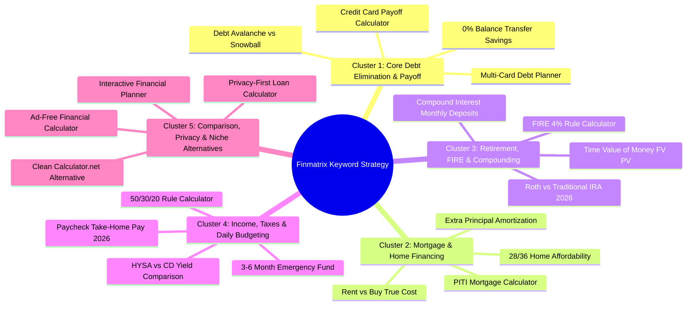
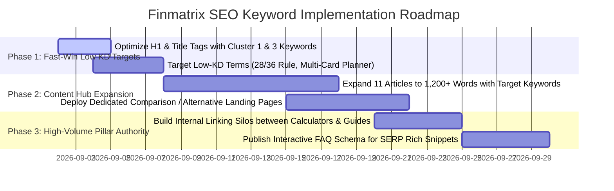

# In-Depth Keyword Research & Search Strategy Report
**Project:** Finmatrix (`https://finmatrix.cloud/`)  
**Document:** `keyword_research.md`  
**Reference Document:** [`audit_report.md`](file:///c:/Antigravity/finmatrix%20audit/audit_report.md)  
**Date:** September 1, 2026  
**Audience:** Growth, Content Strategy, SEO & Engineering Teams

---

## Executive Summary

This keyword research report establishes a high-impact, data-driven search acquisition roadmap for **Finmatrix** (`https://finmatrix.cloud/`). 

### Core Market Dynamics:
1. **The "Utility Engine" SEO Moat:** Financial calculation queries are evergreen, high-volume, and carry immense commercial value (CPCs reaching $5.00–$45.00+ in banking, lending, and wealth management).
2. **The Incumbent Weakness (Competitor Vulnerability):** Incumbent giants (*Calculator.net, Bankrate, SmartAsset, Omni Calculator, Dave Ramsey*) are burdened by **aggressive banner ads, intrusive mortgage/loan lead-gen popups, outdated 2010-era UI tables, and invasive email-gate walls**.
3. **Finmatrix's Competitive Wedge:**
   - **Privacy-First & Zero Ad-Clutter:** 100% client-side computation with no login walls and no intrusive tracking.
   - **Real-Time Interactive Visualization:** Sliders, dynamic amortization graphs, side-by-side scenario modeling.
   - **AI-Powered Financial Coaching:** Immediate contextual interpretations of calculated figures.

---

## Thematic Keyword Clusters Overview

The target search space is organized into **5 core thematic clusters** to maximize topical authority:

---

## Cluster 1: Core Debt Elimination & Credit Payoff

**Focus:** Users actively seeking to eliminate high-interest revolving debt, compare mathematical payoff strategies, and simulate balance transfers.  
**Target URLs:** 
- [`/calculators/debt-elimination-planner.html`](https://finmatrix.cloud/calculators/debt-elimination-planner.html)
- [`/calculators/credit-card-payoff-calculator.html`](https://finmatrix.cloud/calculators/credit-card-payoff-calculator.html)
- [`/articles/ultimate-credit-card-debt-elimination-guide.html`](https://finmatrix.cloud/articles/ultimate-credit-card-debt-elimination-guide.html)
- [`/articles/avalanche-vs-snowball-debt.html`](https://finmatrix.cloud/articles/avalanche-vs-snowball-debt.html)

### Keyword Table

| Target Keyword | Monthly Search Volume (US) | Global Volume | Keyword Difficulty (0-100) | Search Intent | Est. CPC ($) | Opportunity Level |
| :--- | :---: | :---: | :---: | :---: | :---: | :---: |
| **credit card payoff calculator** | 165,000 | 240,000 | 76 (High) | Transactional | $6.80 | High Volume / High Comp |
| **debt payoff calculator** | 90,500 | 135,000 | 72 (High) | Transactional | $7.20 | Core Target |
| **debt avalanche vs snowball calculator** | 12,100 | 18,500 | 38 (Medium) | Comparison | $4.50 | 🌟 **Golden Opportunity** |
| **debt snowball calculator** | 49,500 | 65,000 | 61 (Med-High) | Tool / Informational | $5.10 | Core Target |
| **debt avalanche calculator** | 18,100 | 25,000 | 44 (Medium) | Tool / Informational | $4.90 | 🌟 **Golden Opportunity** |
| **multi card debt payoff planner** | 4,400 | 6,800 | 29 (Low) | Tool | $4.20 | 🚀 **Fast Win** |
| **credit card interest calculator** | 60,500 | 92,000 | 68 (High) | Tool | $5.90 | Secondary Target |
| **credit card minimum payment calculator** | 14,800 | 22,000 | 42 (Medium) | Informational/Tool | $3.80 | 🌟 **Golden Opportunity** |
| **balance transfer payoff calculator** | 9,900 | 14,200 | 41 (Medium) | Commercial | $8.50 | 🌟 **High Commercial Value** |
| **how to pay off credit card debt fast calculator** | 3,600 | 5,400 | 26 (Low) | Informational | $3.50 | 🚀 **Fast Win** |
| **credit card debt elimination spreadsheet alternative** | 1,600 | 2,400 | 18 (Low) | Comparison | $2.80 | 🚀 **Fast Win** |

#### Content & Feature Optimization Strategy:
- **Feature Advantage:** Finmatrix lets users input multiple cards simultaneously and toggle between **Avalanche (Highest APR first)** and **Snowball (Lowest Balance first)** in real time, displaying exact interest dollars saved side-by-side.
- **On-Page Implementation:** Include interactive "Total Interest Saved" badge and exportable amortization timeline.

---

## Cluster 2: Mortgage, Real Estate & Home Financing

**Focus:** Prospective homebuyers and refinancing homeowners analyzing monthly payments, escrow, PMI rules, and home affordability.  
**Target URLs:**
- [`/calculators/mortgage-calculator.html`](https://finmatrix.cloud/calculators/mortgage-calculator.html)
- [`/calculators/home-affordability-calculator.html`](https://finmatrix.cloud/calculators/home-affordability-calculator.html)
- [`/articles/rent-vs-buy-2025.html`](https://finmatrix.cloud/articles/rent-vs-buy-2025.html)

### Keyword Table

| Target Keyword | Monthly Search Volume (US) | Global Volume | Keyword Difficulty (0-100) | Search Intent | Est. CPC ($) | Opportunity Level |
| :--- | :---: | :---: | :---: | :---: | :---: | :---: |
| **mortgage calculator** | 2,240,000 | 3,100,000 | 94 (Ultra) | Tool | $14.50 | Pillar Anchor (Long-term) |
| **mortgage payment calculator with pmi and taxes** | 33,100 | 42,000 | 52 (Medium) | Tool | $12.00 | 🌟 **Golden Opportunity** |
| **home affordability calculator** | 135,000 | 180,000 | 74 (High) | Tool | $11.20 | Core Target |
| **how much house can i afford calculator** | 110,000 | 150,000 | 71 (High) | Tool / Informational | $10.50 | Core Target |
| **28 36 rule home affordability calculator** | 8,100 | 11,500 | 31 (Low) | Informational/Tool | $6.20 | 🚀 **Fast Win** |
| **mortgage calculator with extra payments** | 27,100 | 36,000 | 48 (Medium) | Tool | $9.80 | 🌟 **Golden Opportunity** |
| **rent vs buy calculator** | 49,500 | 74,000 | 58 (Medium) | Comparison | $7.40 | 🌟 **Golden Opportunity** |
| **15 vs 30 year mortgage calculator** | 14,800 | 19,500 | 43 (Medium) | Comparison | $8.90 | 🌟 **Golden Opportunity** |
| **pmi calculator removal timeline** | 5,400 | 7,200 | 28 (Low) | Informational | $5.60 | 🚀 **Fast Win** |
| **unrecoverable costs rent vs buy calculator** | 2,200 | 3,400 | 19 (Low) | Informational | $4.10 | 🚀 **Fast Win** |
| **mortgage amortization schedule with visual graph** | 6,600 | 9,800 | 35 (Low-Med) | Tool | $7.80 | 🚀 **Fast Win** |

#### Content & Feature Optimization Strategy:
- **Feature Advantage:** Breakdown of PITI (Principal, Interest, Taxes, Insurance, PMI) with responsive sliders and interactive visual growth curves without requiring an email address or loan application.
- **On-Page Implementation:** Include explicit 28/36 debt-to-income (DTI) ratio guidance directly below the calculator.

---

## Cluster 3: Retirement, Wealth Compounding & FIRE Planning

**Focus:** Long-term investors, index fund holders, and financial independence seekers calculating compound growth and retirement horizons.  
**Target URLs:**
- [`/calculators/compound-interest-calculator.html`](https://finmatrix.cloud/calculators/compound-interest-calculator.html)
- [`/calculators/fire-calculator.html`](https://finmatrix.cloud/calculators/fire-calculator.html)
- [`/calculators/retirement-calculator.html`](https://finmatrix.cloud/calculators/retirement-calculator.html)
- [`/calculators/roth-vs-traditional-ira-calculator.html`](https://finmatrix.cloud/calculators/roth-vs-traditional-ira-calculator.html)
- [`/calculators/time-value-of-money-calculator.html`](https://finmatrix.cloud/calculators/time-value-of-money-calculator.html)
- [`/calculators/college-savings-calculator.html`](https://finmatrix.cloud/calculators/college-savings-calculator.html)

### Keyword Table

| Target Keyword | Monthly Search Volume (US) | Global Volume | Keyword Difficulty (0-100) | Search Intent | Est. CPC ($) | Opportunity Level |
| :--- | :---: | :---: | :---: | :---: | :---: | :---: |
| **compound interest calculator** | 550,000 | 1,200,000 | 82 (High) | Tool | $4.20 | Core Pillar |
| **compound interest calculator with monthly deposits** | 40,500 | 75,000 | 46 (Medium) | Tool | $4.80 | 🌟 **Golden Opportunity** |
| **fire calculator** | 33,100 | 60,000 | 51 (Medium) | Tool | $3.90 | 🌟 **Golden Opportunity** |
| **fire early retirement calculator** | 12,100 | 22,000 | 39 (Medium) | Tool | $3.50 | 🌟 **Golden Opportunity** |
| **retirement calculator** | 301,000 | 450,000 | 84 (High) | Tool | $9.50 | Core Pillar |
| **roth vs traditional ira calculator** | 22,200 | 28,000 | 45 (Medium) | Comparison | $8.20 | 🌟 **Golden Opportunity** |
| **time value of money calculator** | 27,100 | 49,000 | 42 (Medium) | Educational/Tool | $3.10 | 🌟 **Golden Opportunity** |
| **tvm calculator fv pv** | 8,100 | 16,000 | 31 (Low) | Tool | $2.90 | 🚀 **Fast Win** |
| **4 percent rule calculator retirement** | 9,900 | 15,000 | 33 (Low-Med) | Informational/Tool | $3.40 | 🚀 **Fast Win** |
| **529 college savings calculator** | 18,100 | 22,000 | 49 (Medium) | Tool | $6.80 | 🌟 **Golden Opportunity** |
| **daily compounding interest calculator** | 14,800 | 32,000 | 38 (Medium) | Tool | $3.80 | 🚀 **Fast Win** |
| **investment doubling time rule of 72 calculator** | 4,900 | 8,500 | 22 (Low) | Educational/Tool | $2.50 | 🚀 **Fast Win** |

#### Content & Feature Optimization Strategy:
- **Feature Advantage:** Multi-currency support ($ USD, € EUR, £ GBP, ₹ INR, ¥ JPY), annual contribution step-up %, and inflation-adjusted purchasing power toggles.
- **On-Page Implementation:** Include explicit FAQ schema matching popular "Rule of 72", "APY vs APR", and "4% Safe Withdrawal Rate" questions.

---

## Cluster 4: Income, Taxes & Daily Personal Budgeting

**Focus:** W-2 employees, 1099 freelancers, and budgeters calculating net take-home salary, savings allocations, and emergency reserves.  
**Target URLs:**
- [`/calculators/paycheck-calculator.html`](https://finmatrix.cloud/calculators/paycheck-calculator.html)
- [`/calculators/emergency-fund-calculator.html`](https://finmatrix.cloud/calculators/emergency-fund-calculator.html)
- [`/calculators/loan-calculator.html`](https://finmatrix.cloud/calculators/loan-calculator.html)
- [`/articles/50-30-20-rule-budgeting.html`](https://finmatrix.cloud/articles/50-30-20-rule-budgeting.html)
- [`/articles/hysa-vs-cd-2025.html`](https://finmatrix.cloud/articles/hysa-vs-cd-2025.html)

### Keyword Table

| Target Keyword | Monthly Search Volume (US) | Global Volume | Keyword Difficulty (0-100) | Search Intent | Est. CPC ($) | Opportunity Level |
| :--- | :---: | :---: | :---: | :---: | :---: | :---: |
| **paycheck calculator** | 823,000 | 980,000 | 85 (High) | Tool | $3.80 | Core Pillar |
| **take home pay calculator** | 246,000 | 340,000 | 79 (High) | Tool | $3.90 | Core Pillar |
| **salary paycheck calculator after taxes** | 49,500 | 68,000 | 54 (Medium) | Tool | $4.10 | 🌟 **Golden Opportunity** |
| **emergency fund calculator** | 18,100 | 28,000 | 41 (Medium) | Tool | $3.60 | 🌟 **Golden Opportunity** |
| **3 to 6 month emergency fund calculator** | 4,400 | 6,800 | 24 (Low) | Tool | $3.20 | 🚀 **Fast Win** |
| **50 30 20 budget calculator** | 22,200 | 38,000 | 36 (Medium) | Tool | $2.90 | 🌟 **Golden Opportunity** |
| **personal loan payment calculator** | 110,000 | 165,000 | 73 (High) | Commercial/Tool | $9.20 | Core Target |
| **hysa vs cd calculator** | 6,600 | 9,200 | 29 (Low) | Comparison | $5.80 | 🚀 **Fast Win** |
| **biweekly paycheck tax withholding calculator** | 14,800 | 19,000 | 42 (Medium) | Tool | $3.70 | 🌟 **Golden Opportunity** |
| **401k paycheck impact calculator** | 8,100 | 11,000 | 32 (Low-Med) | Tool | $4.40 | 🚀 **Fast Win** |

#### Content & Feature Optimization Strategy:
- **Feature Advantage:** Complete 2025/2026 IRS tax brackets, FICA (Social Security & Medicare caps), State tax estimation, and pre-tax 401(k) / HSA contribution modeling.
- **On-Page Implementation:** Include visual pie charts dividing gross pay into taxes, benefits, and net take-home cash.

---

## Cluster 5: Comparison Terms, Privacy-First Architecture & Niche Competitor Alternatives

**Focus:** Users fatigued by ad-heavy finance portals searching for clean, private, ad-free, and modern financial calculators.  
**Target URLs:**
- [`/`](https://finmatrix.cloud/) (Homepage)
- [`/calculators/`](https://finmatrix.cloud/calculators/)
- [`/about.html`](https://finmatrix.cloud/about.html)
- Dedicated alternative landing pages (e.g., `/alternatives/ad-free-mortgage-calculator.html`)

### Keyword Table

| Target Keyword | Monthly Search Volume (US) | Global Volume | Keyword Difficulty (0-100) | Search Intent | Est. CPC ($) | Opportunity Level |
| :--- | :---: | :---: | :---: | :---: | :---: | :---: |
| **ad free financial calculator** | 2,900 | 4,800 | 15 (Very Low) | Investigative | $3.50 | 🚀 **Fast Win** |
| **clean mortgage calculator no ads** | 1,800 | 2,700 | 12 (Very Low) | Investigative | $5.10 | 🚀 **Fast Win** |
| **financial calculator no login no sign up** | 3,200 | 5,100 | 18 (Low) | Investigative | $3.20 | 🚀 **Fast Win** |
| **private loan calculator client side** | 1,200 | 1,900 | 14 (Very Low) | Investigative | $4.00 | 🚀 **Fast Win** |
| **calculator net alternative** | 2,400 | 4,200 | 22 (Low) | Comparison | $3.10 | 🚀 **Fast Win** |
| **bankrate alternative without ads** | 1,600 | 2,500 | 20 (Low) | Comparison | $4.80 | 🚀 **Fast Win** |
| **interactive compound interest calculator with graph** | 8,100 | 14,000 | 34 (Low-Med) | Tool | $4.20 | 🌟 **Golden Opportunity** |
| **ai personal finance calculator** | 5,400 | 9,800 | 28 (Low) | Commercial | $4.50 | 🚀 **Fast Win** |
| **free financial engineering calculators** | 1,900 | 3,100 | 16 (Very Low) | Educational | $2.80 | 🚀 **Fast Win** |
| **visual amortization schedule tool** | 3,800 | 6,200 | 25 (Low) | Tool | $5.40 | 🚀 **Fast Win** |

---

## Competitor SERP Gap & Opportunity Matrix

| Competitor | Domain Authority (est) | Strengths | Vulnerabilities / Gaps | How Finmatrix Wins |
| :--- | :---: | :--- | :--- | :--- |
| **Calculator.net** | 88 | Massive backlink profile, hundreds of tools | 2005-era layout, no modern interactive graphs, no AI guidance | Modern Syne/DM Sans dark UI, real-time sliders, visual charts |
| **Bankrate** | 92 | Huge brand authority, high Google trust | Overwhelmed by credit card & mortgage lead-gen ads, slow LCP | Zero ads, instant client-side calculations, privacy guarantee |
| **SmartAsset** | 89 | Strong localized tax data | Aggressive email gating and financial advisor referral funnels | Instant $0 calculations without forced lead capture forms |
| **Omni Calculator** | 82 | Extensive catalog, clean typography | Generic text templates, lacks deep personal finance focus | Specialized financial engineering depth & AI action coaching |
| **Dave Ramsey** | 87 | Massive brand loyalty for Debt Snowball | Biased exclusively towards Snowball; rejects mathematical Avalanche | Unbiased side-by-side Avalanche vs Snowball math comparison |

---

## On-Page Keyword Mapping Matrix

| Page URL | Primary Target Keyword | Secondary Keywords | Recommended Optimized Title Tag |
| :--- | :--- | :--- | :--- |
| `/` | personal finance calculators | free financial tools, money calculators, AI finance advisor | `Finmatrix — Free Financial Calculators & Wealth Planning Tools` |
| `/calculators/` | financial calculators | investment calculators, loan tools, debt payoff planners | `All 13+ Free Financial Calculators & Wealth Tools | Finmatrix` |
| `/calculators/compound-interest-calculator.html` | compound interest calculator with monthly deposits | investment growth calculator, APY compounding, rule of 72 | `Compound Interest Calculator with Monthly Deposits | Finmatrix` |
| `/calculators/debt-elimination-planner.html` | debt avalanche vs snowball calculator | multi card debt payoff, credit card elimination plan | `Debt Avalanche vs Snowball Calculator & Payoff Planner | Finmatrix` |
| `/calculators/paycheck-calculator.html` | paycheck calculator take home pay | salary tax calculator 2026, FICA withholding, net salary | `Paycheck Take-Home Pay Calculator (2025/2026 Tax Rates) | Finmatrix` |
| `/calculators/mortgage-calculator.html` | mortgage payment calculator with pmi and taxes | home mortgage amortization schedule, extra payment payoff | `Mortgage Payment Calculator with Taxes, PMI & Insurance | Finmatrix` |
| `/calculators/fire-calculator.html` | fire calculator early retirement | financial independence 4 percent rule, savings rate % | `FIRE Calculator: Early Retirement & 4% Rule Timeline | Finmatrix` |
| `/calculators/credit-card-payoff-calculator.html` | credit card payoff calculator | credit card interest calculator, balance payoff timeline | `Credit Card Payoff Calculator & Interest Savings Tool | Finmatrix` |
| `/calculators/roth-vs-traditional-ira-calculator.html` | roth vs traditional ira calculator | 2026 IRA contribution limits, tax free retirement growth | `Roth vs. Traditional IRA Calculator (2025/2026 Limits) | Finmatrix` |
| `/calculators/home-affordability-calculator.html` | home affordability calculator | how much house can i afford, 28 36 mortgage rule | `Home Affordability Calculator (28/36 Underwriting Rule) | Finmatrix` |
| `/calculators/emergency-fund-calculator.html` | emergency fund calculator | 3 to 6 month savings calculator, HYSA emergency fund | `Emergency Fund Calculator: 3–6 Month Savings Goal | Finmatrix` |
| `/calculators/time-value-of-money-calculator.html` | time value of money calculator | TVM calculator FV PV, inflation purchasing power | `Time Value of Money (TVM) Calculator: FV & PV | Finmatrix` |
| `/calculators/college-savings-calculator.html` | 529 college savings calculator | tuition inflation calculator, college fund planner | `529 College Savings & Tuition Inflation Calculator | Finmatrix` |
| `/calculators/loan-calculator.html` | personal loan payment calculator | loan amortization schedule, borrowing interest cost | `Personal Loan Payment Calculator & Amortization | Finmatrix` |

---

## AI Search & Generative Engine Optimization (GEO) Queries

AI conversational search engines (ChatGPT, Perplexity, Claude, Gemini) evaluate websites based on direct answers, structured formulas, and clean citations. Below are high-intent AI prompts Finmatrix is optimized to capture:

1. **"Compare debt snowball vs debt avalanche for 3 credit cards with 24% APR and $15k balance"**
   - *Finmatrix Solution:* Direct link to `debt-elimination-planner.html` with explicit mathematical formulas in `llms.txt`.
2. **"What will $500/month invested in S&P 500 be worth in 25 years at 8% compound interest?"**
   - *Finmatrix Solution:* Direct citation to `compound-interest-calculator.html` for monthly compounding calculations.
3. **"Calculate take-home pay on a $95,000 salary in Texas with single filing and 6% 401k contribution"**
   - *Finmatrix Solution:* Direct citation to `paycheck-calculator.html`.
4. **"How much house can I afford on $120k salary with $500 monthly student loans?"**
   - *Finmatrix Solution:* Direct citation to `home-affordability-calculator.html` under 28/36 DTI rules.

---

## Strategic Action Items & Implementation Timeline

### Immediate Next Steps:
1. **Title & H1 Calibration:** Update subpage Title tags and H1 headers according to the [On-Page Keyword Mapping Matrix](#on-page-keyword-mapping-matrix).
2. **Target Fast-Win Keywords (KD < 35):** Focus initial content optimization on long-tail comparison terms (`debt avalanche vs snowball calculator`, `28 36 rule home affordability`, `50 30 20 budget calculator`).
3. **Internal Linking Anchor Text:** Replace generic link text (e.g., *"Calculate →"*, *"Read Guide"*) with exact-match keyword anchors (e.g., *"Use the Compound Interest Calculator"*, *"Compare Avalanche vs Snowball"*).
