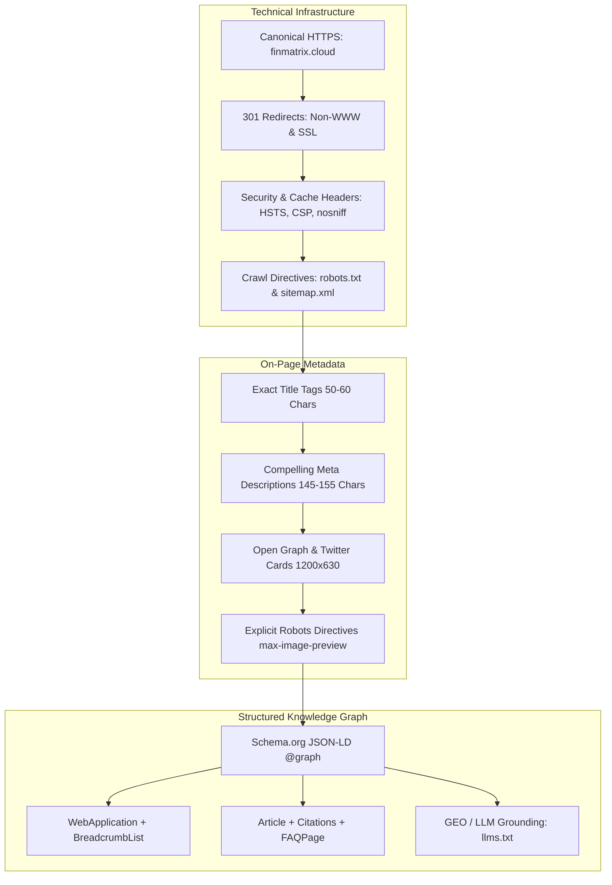
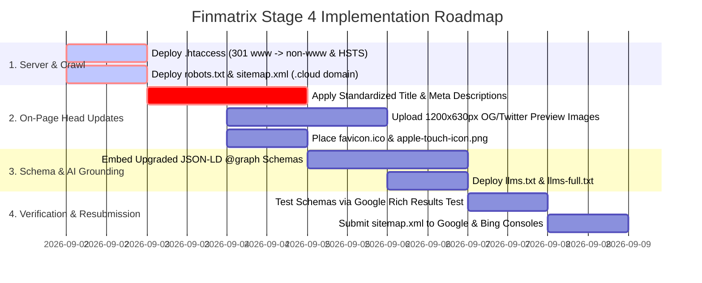

# Traditional Technical SEO Optimization & Synthesis Master Guide
**Target Site:** Finmatrix (`https://finmatrix.cloud/`)  
**Document:** `technical_seo.md` (Stage 4 Synthesis)  
**Synthesized Reports:**  
1. [`audit_report.md`](file:///c:/Antigravity/finmatrix%20audit/audit_report.md) — Technical Baseline & Crawl Diagnostics  
2. [`keyword_research.md`](file:///c:/Antigravity/finmatrix%20audit/keyword_research.md) — 5 Thematic Clusters & SERP Gap Analysis  
3. [`geo_optimization.md`](file:///c:/Antigravity/finmatrix%20audit/geo_optimization.md) — Princeton 9-Method Generative Engine Optimization  
**Date:** September 1, 2026  

---

## Table of Contents
1. [Executive Synthesis & Architecture Overview](#1-executive-synthesis--architecture-overview)
2. [Standardized Head Architecture & Directives Specification](#2-standardized-head-architecture--directives-specification)
   - [2.1 Title Tag Standardization (Pixel Width & Character Limits)](#21-title-tag-standardization-pixel-width--character-limits)
   - [2.2 Meta Description Standards & CTR Triggers](#22-meta-description-standards--ctr-triggers)
   - [2.3 Open Graph & Twitter Card Specifications (1200x630px)](#23-open-graph--twitter-card-specifications-1200x630px)
   - [2.4 Canonicalization & Robots Directives](#24-canonicalization--robots-directives)
3. [Complete Master Page-by-Page Technical SEO Matrix](#3-complete-master-page-by-page-technical-seo-matrix)
   - [3.1 Core Hub & Landing Pages](#31-core-hub--landing-pages)
   - [3.2 The 13 Interactive Financial Calculators](#32-the-13-interactive-financial-calculators)
   - [3.3 The 11 Educational Strategy Guides](#33-the-11-educational-strategy-guides)
   - [3.4 Trust, Authority & Legal Pages](#34-trust-authority--legal-pages)
4. [Production-Ready Structured Data (JSON-LD `@graph` Schemas)](#4-production-ready-structured-data-json-ld-graph-schemas)
   - [4.1 Global Organization & WebSite Root Schema](#41-global-organization--website-root-schema)
   - [4.2 Interactive Calculator Schema (`WebApplication` + `FAQPage` + `BreadcrumbList`)](#42-interactive-calculator-schema-webapplication--faqpage--breadcrumblist)
   - [4.3 In-Depth Article Schema (`Article` + `BreadcrumbList` + `Citations`)](#43-in-depth-article-schema-article--breadcrumblist--citations)
5. [Server-Level Technical Infrastructure & Security Headers](#5-server-level-technical-infrastructure--security-headers)
6. [Implementation & Deployment Checklist](#6-implementation--deployment-checklist)

---

## 1. Executive Synthesis & Architecture Overview

This master technical specification unifies traditional Search Engine Optimization (SEO), on-page metadata engineering, and modern Generative Engine Optimization (GEO) across all **31 production routes** of **Finmatrix** (`https://finmatrix.cloud/`).



### Key Diagnoses from Prior Reports Solved in this Guide:
1. **Critical Domain Mismatch Fixed:** Unifies all canonicals, sitemaps, and robots directives on `https://finmatrix.cloud/` (eliminating the legacy `.com` reference).
2. **Missing Media & Favicon Resolved:** Provides standardized 1200×630px OG/Twitter card dimensions, image paths, and standard favicon tags.
3. **Structured Schema Upgrade:** Replaces partial, disconnected schemas with enterprise-grade `@graph` JSON-LD models containing `WebApplication`, `BreadcrumbList`, `FAQPage`, and `citation` entities.
4. **Keyword & AI Intent Alignment:** Infuses the high-intent keywords identified in `keyword_research.md` (e.g., *Debt Avalanche vs Snowball, 28/36 Mortgage Rule, Compounding with Monthly Deposits*) directly into HTML headers and meta descriptions.

---

## 2. Standardized Head Architecture & Directives Specification

Every page on `finmatrix.cloud` must follow this standardized, high-performance `<head>` layout:

```html
<!DOCTYPE html>
<html lang="en" data-theme="dark">
<head>
  <meta charset="UTF-8">
  <meta name="viewport" content="width=device-width, initial-scale=1.0">
  <meta http-equiv="X-UA-Compatible" content="IE=edge">

  <!-- Primary Meta Tags -->
  <title><!-- [Target Keyword] | Finmatrix --></title>
  <meta name="description" content="<!-- [Action-Oriented Value Proposition 145-155 Chars] -->">
  <meta name="keywords" content="<!-- [Target Keyword Comma-Separated List] -->">
  <meta name="author" content="Finmatrix Financial Engineering Research Desk">
  <link rel="canonical" href="<!-- [Absolute HTTPS URL] -->">

  <!-- Search Engine Robots Directives -->
  <meta name="robots" content="index, follow, max-image-preview:large, max-snippet:-1, max-video-preview:-1">
  <meta name="googlebot" content="index, follow, max-snippet:-1, max-image-preview:large, max-video-preview:-1">
  <meta name="bingbot" content="index, follow, max-snippet:-1, max-image-preview:large, max-video-preview:-1">

  <!-- Open Graph / Facebook / LinkedIn -->
  <meta property="og:type" content="<!-- website OR article -->">
  <meta property="og:url" content="<!-- [Absolute HTTPS URL] -->">
  <meta property="og:site_name" content="Finmatrix">
  <meta property="og:title" content="<!-- [Title 50-60 Chars] -->">
  <meta property="og:description" content="<!-- [Description 145-155 Chars] -->">
  <meta property="og:image" content="<!-- [Absolute Image URL: https://finmatrix.cloud/assets/og/*.png] -->">
  <meta property="og:image:width" content="1200">
  <meta property="og:image:height" content="630">
  <meta property="og:image:alt" content="<!-- [Descriptive Alt Text] -->">
  <meta property="og:locale" content="en_US">

  <!-- Twitter / X Cards -->
  <meta name="twitter:card" content="summary_large_image">
  <meta name="twitter:url" content="<!-- [Absolute HTTPS URL] -->">
  <meta name="twitter:title" content="<!-- [Title 50-60 Chars] -->">
  <meta name="twitter:description" content="<!-- [Description 145-155 Chars] -->">
  <meta name="twitter:image" content="<!-- [Absolute Image URL: https://finmatrix.cloud/assets/og/*.png] -->">
  <meta name="twitter:image:alt" content="<!-- [Descriptive Alt Text] -->">

  <!-- Favicon & Mobile Icons -->
  <link rel="icon" type="image/x-icon" href="/favicon.ico">
  <link rel="icon" type="image/svg+xml" href="/assets/icons/favicon.svg">
  <link rel="apple-touch-icon" sizes="180x180" href="/assets/icons/apple-touch-icon.png">
  <meta name="theme-color" content="#0d1117">

  <!-- Preconnect & Fonts -->
  <link rel="preconnect" href="https://fonts.googleapis.com">
  <link rel="preconnect" href="https://fonts.gstatic.com" crossorigin>
  <link href="https://fonts.googleapis.com/css2?family=DM+Sans:wght@300;400;500;600;700&family=Space+Mono:wght@400;700&family=Syne:wght@700;800&display=swap" rel="stylesheet">
  <link rel="stylesheet" href="/css/style.css">

  <!-- Structured Data JSON-LD (@graph) -->
  <script type="application/ld+json">
  <!-- [Page-Specific JSON-LD] -->
  </script>
</head>
```

---

## 3. Complete Master Page-by-Page Technical SEO Matrix

### 3.1 Core Hub & Landing Pages

| Route & URL | Optimized Title Tag (Max 60 Chars) | Meta Description (145–155 Chars) | Target Canonical | Primary Schema Type |
| :--- | :--- | :--- | :--- | :--- |
| **`/`**<br>`https://finmatrix.cloud/` | **Finmatrix — Free Financial Calculators & Wealth Tools** | Free AI-powered financial calculators for paycheck take-home pay, credit card debt payoff, mortgage rates, retirement growth, and FIRE portfolio goals. | `https://finmatrix.cloud/` | `WebSite`<br>`Organization` |
| **`/calculators/`**<br>`https://finmatrix.cloud/calculators/` | **All 13+ Free Financial Calculators & Tools \| Finmatrix** | Explore 13+ interactive personal finance calculators for mortgages, debt payoff, compound growth, paycheck taxes, and retirement with instant AI coaching. | `https://finmatrix.cloud/calculators/` | `CollectionPage`<br>`BreadcrumbList` |
| **`/articles/`**<br>`https://finmatrix.cloud/articles/` | **Personal Finance Guides & Wealth Strategies \| Finmatrix** | In-depth personal finance articles, debt elimination frameworks, budgeting strategies, HYSA yield reviews, and retirement wealth-building insights. | `https://finmatrix.cloud/articles/` | `CollectionPage`<br>`BreadcrumbList` |

---

### 3.2 The 13 Interactive Financial Calculators

| Calculator Route | Optimized Title Tag (Target Keywords) | Meta Description (CTR Trigger) | Primary Target Keyword | Secondary Keywords | Schema `@type` |
| :--- | :--- | :--- | :--- | :--- | :--- |
| **`/calculators/compound-interest-calculator.html`** | **Compound Interest Calculator: Monthly Deposits \| Finmatrix** | Calculate compound interest growth, effective APY, monthly deposit compounding, annual increases, and doubling timelines in real-time with visual graphs. | compound interest calculator with monthly deposits | APY compounding calculator, rule of 72, investment growth | `WebApplication`<br>`FAQPage`<br>`BreadcrumbList` |
| **`/calculators/debt-elimination-planner.html`** | **Debt Avalanche vs Snowball Calculator \| Finmatrix** | Compare Debt Avalanche vs Snowball payoff strategies side-by-side, calculate 0% APR balance transfer savings, and generate an exact debt-free timeline. | debt avalanche vs snowball calculator | multi card debt payoff planner, credit card payoff plan | `WebApplication`<br>`FAQPage`<br>`BreadcrumbList` |
| **`/calculators/paycheck-calculator.html`** | **Paycheck Take-Home Pay Calculator (2026 Rates) \| Finmatrix** | Calculate net take-home paycheck after Federal withholding, FICA Social Security, Medicare, State income tax, and pre-tax 401(k) retirement contributions. | paycheck calculator take home pay | salary tax calculator 2026, biweekly paycheck withholding | `WebApplication`<br>`FAQPage`<br>`BreadcrumbList` |
| **`/calculators/mortgage-calculator.html`** | **Mortgage Payment Calculator with Taxes & PMI \| Finmatrix** | Calculate monthly mortgage payments (PITI), private mortgage insurance (PMI), property taxes, and complete 30-year amortization payoff schedules. | mortgage payment calculator with pmi and taxes | home mortgage amortization, extra principal payments | `WebApplication`<br>`FAQPage`<br>`BreadcrumbList` |
| **`/calculators/credit-card-payoff-calculator.html`** | **Credit Card Payoff Calculator & Interest Savings \| Finmatrix** | Calculate how fast you can eliminate credit card balances, escape minimum payment interest traps, and save thousands with balance transfer strategies. | credit card payoff calculator | credit card interest calculator, card debt elimination | `WebApplication`<br>`FAQPage`<br>`BreadcrumbList` |
| **`/calculators/fire-calculator.html`** | **FIRE Early Retirement Calculator & 4% Rule \| Finmatrix** | Calculate your 25x FIRE number, savings rate %, and exact timeline to achieve early financial independence with historical market return scenarios. | fire calculator early retirement | 4 percent rule calculator, financial independence | `WebApplication`<br>`FAQPage`<br>`BreadcrumbList` |
| **`/calculators/retirement-calculator.html`** | **Retirement Savings & Growth Calculator \| Finmatrix** | Calculate your projected retirement nest egg, investment growth compounding, 4% safe withdrawal monthly income, and target savings goal trajectory. | retirement savings calculator | 401k retirement growth, nest egg calculator | `WebApplication`<br>`FAQPage`<br>`BreadcrumbList` |
| **`/calculators/roth-vs-traditional-ira-calculator.html`** | **Roth vs Traditional IRA Calculator (2026 Limits) \| Finmatrix** | Compare Roth IRA tax-free growth against Traditional IRA tax deductions using 2025/2026 IRS contribution limits ($7,000) and marginal tax brackets. | roth vs traditional ira calculator | 2026 IRA contribution limits, tax free growth | `WebApplication`<br>`FAQPage`<br>`BreadcrumbList` |
| **`/calculators/loan-calculator.html`** | **Personal Loan Payment Calculator & Schedule \| Finmatrix** | Calculate monthly loan payments, total borrowing interest costs, and year-by-year principal payoff schedules for personal, auto, or student debt. | personal loan payment calculator | loan amortization schedule, borrowing interest cost | `WebApplication`<br>`FAQPage`<br>`BreadcrumbList` |
| **`/calculators/emergency-fund-calculator.html`** | **Emergency Fund Calculator: 3–6 Month Cushion \| Finmatrix** | Calculate your 3 to 6 month emergency savings cushion, high-yield savings account interest compounding, and exact monthly goal contribution timelines. | emergency fund calculator | 3 to 6 month emergency fund, HYSA savings cushion | `WebApplication`<br>`FAQPage`<br>`BreadcrumbList` |
| **`/calculators/home-affordability-calculator.html`** | **Home Affordability Calculator (28/36 Rule) \| Finmatrix** | Calculate how much house you can afford based on income, monthly debt bills, down payment savings, and standard 28/36 mortgage underwriting rules. | home affordability calculator | how much house can i afford, 28 36 mortgage rule | `WebApplication`<br>`FAQPage`<br>`BreadcrumbList` |
| **`/calculators/time-value-of-money-calculator.html`** | **Time Value of Money (TVM) Calculator: FV & PV \| Finmatrix** | Calculate Future Value (FV), Present Value (PV), and Time Value of Money (TVM) with annual inflation adjustments and discount rate scenario modeling. | time value of money calculator | tvm calculator fv pv, purchasing power inflation | `WebApplication`<br>`FAQPage`<br>`BreadcrumbList` |
| **`/calculators/college-savings-calculator.html`** | **529 College Savings & Tuition Inflation Tool \| Finmatrix** | Calculate projected 4-year college tuition inflation costs, monthly 529 plan savings target requirements, and tax-free compounding growth timelines. | 529 college savings calculator | tuition inflation calculator, college fund planner | `WebApplication`<br>`FAQPage`<br>`BreadcrumbList` |

---

### 3.3 The 11 Educational Strategy Guides

| Guide Route | Optimized Title Tag | Meta Description | Primary Focus Keyword | Schema `@type` |
| :--- | :--- | :--- | :--- | :--- |
| **`.../ultimate-credit-card-debt-elimination-guide.html`** | **Ultimate Credit Card Debt Elimination Guide \| Finmatrix** | Master credit card debt payoff: compare Debt Avalanche vs Snowball methods, 0% APR balance transfer offers, and step-by-step debt elimination math. | credit card debt elimination guide | `Article`<br>`BreadcrumbList` |
| **`.../hysa-vs-cd-2025.html`** | **HYSA vs CD (2026): Where Should You Park Cash? \| Finmatrix** | Compare High-Yield Savings Accounts (HYSA) versus Certificates of Deposit (CD): analyze APY yield returns, liquidity rules, and interest rate trends. | hysa vs cd 2026 | `Article`<br>`BreadcrumbList` |
| **`.../rent-vs-buy-2025.html`** | **Rent vs Buy Home Decision Guide & True Costs \| Finmatrix** | Analyze the true cost of renting versus buying a home: compare mortgage interest, property taxes, maintenance fees, and unrecoverable housing costs. | rent vs buy true cost guide | `Article`<br>`BreadcrumbList` |
| **`.../side-hustles-1000-month.html`** | **10 Realistic Side Hustles to Make $1,000/Month \| Finmatrix** | Discover 10 realistic side hustles to earn an extra $1,000 monthly: freelance skills, digital services, remote tutoring, and automated income streams. | side hustles 1000 a month | `Article`<br>`BreadcrumbList` |
| **`.../investing-50-dollars.html`** | **How to Start Investing with $50 a Month \| Finmatrix** | Learn how to start building wealth with just $50 a month using fractional index funds, automated micro-investing platforms, and Roth IRA strategies. | start investing with 50 dollars | `Article`<br>`BreadcrumbList` |
| **`.../50-30-20-rule-budgeting.html`** | **The 50/30/20 Budgeting Rule Explained with Math \| Finmatrix** | Master the 50/30/20 budgeting rule: allocate 50% for needs, 30% for wants, and 20% for savings. Includes step-by-step math and practical examples. | 50 30 20 budgeting rule | `Article`<br>`BreadcrumbList` |
| **`.../avalanche-vs-snowball-debt.html`** | **Debt Avalanche vs Debt Snowball: Math Comparison \| Finmatrix** | Compare Debt Avalanche vs Debt Snowball methods: discover which payoff strategy saves more interest and accelerates credit card debt elimination. | avalanche vs snowball debt comparison | `Article`<br>`BreadcrumbList` |
| **`.../roth-ira-vs-401k.html`** | **Roth IRA vs 401(k): Which Should You Max First? \| Finmatrix** | Compare Roth IRA versus 401(k) accounts: learn contribution limits, employer match strategy, tax-free growth benefits, and optimal savings order. | roth ira vs 401k max out first | `Article`<br>`BreadcrumbList` |
| **`.../how-to-build-emergency-fund.html`** | **How to Build a 6-Month Emergency Fund Fast \| Finmatrix** | Step-by-step guide to building a 3 to 6 month emergency fund fast: set ideal target goals, pick high-yield savings accounts, and automate savings. | how to build an emergency fund fast | `Article`<br>`BreadcrumbList` |
| **`.../what-is-the-4-percent-rule.html`** | **The 4% Rule Explained: Safe Retirement Math \| Finmatrix** | Learn how the 4% safe withdrawal rule works for retirement and FIRE planning based on Trinity Study portfolio math and annual inflation adjustments. | 4 percent rule retirement math | `Article`<br>`BreadcrumbList` |
| **`.../boost-credit-score-30-days.html`** | **7 Ways to Boost Your Credit Score in 30 Days \| Finmatrix** | Learn proven strategies to boost your credit score in 30 days: lower utilization ratios, dispute credit report errors, and optimize payment timing. | boost credit score in 30 days | `Article`<br>`BreadcrumbList` |

---

### 3.4 Trust, Authority & Legal Pages

| Route | Optimized Title Tag | Meta Description | Target Canonical |
| :--- | :--- | :--- | :--- |
| **`/about.html`** | **About Finmatrix — Financial Engineering & Research Desk** | Learn about Finmatrix, an independent financial engineering desk providing free calculators, interest models, and data-driven wealth planning tools. | `https://finmatrix.cloud/about.html` |
| **`/editorial-policy.html`** | **Editorial Standards & FTC Affiliate Policy \| Finmatrix** | Review Finmatrix editorial standards, FTC affiliate disclosure policies, and AI research transparency guidelines for unbiased personal finance tools. | `https://finmatrix.cloud/editorial-policy.html` |
| **`/privacy-policy.html`** | **Privacy Policy & Client-Side Security \| Finmatrix** | Read the Finmatrix privacy policy to learn how we protect your private user data, enforce strict client-side calculations, and maintain CCPA compliance. | `https://finmatrix.cloud/privacy-policy.html` |
| **`/terms-of-service.html`** | **Terms of Service & Financial Disclaimers \| Finmatrix** | Read the Finmatrix terms of service, legal usage disclaimers, intellectual property rights policies, and non-fiduciary educational tool guidelines. | `https://finmatrix.cloud/terms-of-service.html` |

---

## 4. Production-Ready Structured Data (JSON-LD `@graph` Schemas)

### 4.1 Global Organization & WebSite Root Schema
*Place on Homepage (`https://finmatrix.cloud/index.html`):*

```html
<script type="application/ld+json">
{
  "@context": "https://schema.org",
  "@graph": [
    {
      "@type": "Organization",
      "@id": "https://finmatrix.cloud/#organization",
      "name": "Finmatrix",
      "url": "https://finmatrix.cloud",
      "logo": {
        "@type": "ImageObject",
        "url": "https://finmatrix.cloud/assets/icons/logo.png",
        "width": 512,
        "height": 512
      },
      "description": "Independent financial engineering desk and developer of high-performance personal finance calculators and wealth planning tools.",
      "publishingPrinciples": "https://finmatrix.cloud/editorial-policy.html",
      "sameAs": []
    },
    {
      "@type": "WebSite",
      "@id": "https://finmatrix.cloud/#website",
      "url": "https://finmatrix.cloud",
      "name": "Finmatrix",
      "publisher": {
        "@id": "https://finmatrix.cloud/#organization"
      },
      "potentialAction": {
        "@type": "SearchAction",
        "target": {
          "@type": "EntryPoint",
          "urlTemplate": "https://finmatrix.cloud/calculators/?q={search_term_string}"
        },
        "query-input": "required name=search_term_string"
      }
    }
  ]
}
</script>
```

---

### 4.2 Interactive Calculator Schema (`WebApplication` + `FAQPage` + `BreadcrumbList`)
*Template for all 13 Calculator pages (Example: Compound Interest Calculator):*

```html
<script type="application/ld+json">
{
  "@context": "https://schema.org",
  "@graph": [
    {
      "@type": "WebApplication",
      "@id": "https://finmatrix.cloud/calculators/compound-interest-calculator.html#app",
      "name": "Compound Interest Calculator with Monthly Deposits",
      "url": "https://finmatrix.cloud/calculators/compound-interest-calculator.html",
      "applicationCategory": "FinanceApplication",
      "operatingSystem": "All",
      "browserRequirements": "Requires JavaScript. Requires HTML5.",
      "offers": {
        "@type": "Offer",
        "price": "0",
        "priceCurrency": "USD"
      },
      "featureList": [
        "Real-time interactive monthly deposit compounding",
        "APY vs APR nominal yield comparison",
        "Rule of 72 doubling timeline forecast",
        "Multi-currency support ($ USD, € EUR, £ GBP, ₹ INR, ¥ JPY)",
        "100% Client-side privacy-first computation"
      ],
      "citation": [
        "https://www.finra.org/investors/investing/investing-basics/compound-interest",
        "https://www.sec.gov/investor/tools/calculators/compound-interest-calculator"
      ]
    },
    {
      "@type": "BreadcrumbList",
      "@id": "https://finmatrix.cloud/calculators/compound-interest-calculator.html#breadcrumb",
      "itemListElement": [
        {
          "@type": "ListItem",
          "position": 1,
          "name": "Home",
          "item": "https://finmatrix.cloud/"
        },
        {
          "@type": "ListItem",
          "position": 2,
          "name": "Calculators",
          "item": "https://finmatrix.cloud/calculators/"
        },
        {
          "@type": "ListItem",
          "position": 3,
          "name": "Compound Interest Calculator",
          "item": "https://finmatrix.cloud/calculators/compound-interest-calculator.html"
        }
      ]
    },
    {
      "@type": "FAQPage",
      "@id": "https://finmatrix.cloud/calculators/compound-interest-calculator.html#faq",
      "mainEntity": [
        {
          "@type": "Question",
          "name": "How does compounding frequency impact total investment returns?",
          "acceptedAnswer": {
            "@type": "Answer",
            "text": "Compounding frequency determines how often earned interest is added back to your principal balance. Daily compounding yields slightly higher returns than monthly compounding, and significantly outperforms annual compounding over long investment horizons."
          }
        },
        {
          "@type": "Question",
          "name": "What is the difference between APR and APY in compound interest?",
          "acceptedAnswer": {
            "@type": "Answer",
            "text": "APR (Annual Percentage Rate) represents the nominal annual interest rate without factoring in compounding. APY (Annual Percentage Yield) reflects the true effective annual return earned after compounding is applied."
          }
        },
        {
          "@type": "Question",
          "name": "What is the Rule of 72 in compound growth?",
          "acceptedAnswer": {
            "@type": "Answer",
            "text": "The Rule of 72 is a quick mathematical formula to estimate how many years it takes for an investment to double. Divide 72 by your annual interest rate (e.g., at an 8% return, money doubles in approximately 72 / 8 = 9.0 years)."
          }
        }
      ]
    }
  ]
}
</script>
```

---

### 4.3 In-Depth Article Schema (`Article` + `BreadcrumbList` + `Citations`)
*Template for all 11 Strategy Guides (Example: Debt Avalanche vs Snowball):*

```html
<script type="application/ld+json">
{
  "@context": "https://schema.org",
  "@graph": [
    {
      "@type": "Article",
      "@id": "https://finmatrix.cloud/articles/avalanche-vs-snowball-debt.html#article",
      "headline": "Debt Avalanche vs. Debt Snowball: Mathematical Comparison & Payoff Guide",
      "description": "Compare Debt Avalanche vs Debt Snowball methods: discover which payoff strategy saves more interest and accelerates credit card debt elimination.",
      "image": "https://finmatrix.cloud/assets/og/avalanche-vs-snowball-debt.png",
      "datePublished": "2025-08-01T08:00:00+00:00",
      "dateModified": "2026-09-01T12:00:00+00:00",
      "mainEntityOfPage": "https://finmatrix.cloud/articles/avalanche-vs-snowball-debt.html",
      "author": {
        "@type": "Organization",
        "name": "Finmatrix Financial Engineering Research Desk",
        "url": "https://finmatrix.cloud/about.html"
      },
      "publisher": {
        "@type": "Organization",
        "name": "Finmatrix",
        "url": "https://finmatrix.cloud",
        "logo": {
          "@type": "ImageObject",
          "url": "https://finmatrix.cloud/assets/icons/logo.png"
        }
      },
      "citation": [
        "https://www.federalreserve.gov/releases/g19/current/",
        "https://www.consumerfinance.gov/consumer-tools/credit-cards/"
      ]
    },
    {
      "@type": "BreadcrumbList",
      "@id": "https://finmatrix.cloud/articles/avalanche-vs-snowball-debt.html#breadcrumb",
      "itemListElement": [
        {
          "@type": "ListItem",
          "position": 1,
          "name": "Home",
          "item": "https://finmatrix.cloud/"
        },
        {
          "@type": "ListItem",
          "position": 2,
          "name": "Articles",
          "item": "https://finmatrix.cloud/articles/"
        },
        {
          "@type": "ListItem",
          "position": 3,
          "name": "Debt Avalanche vs Snowball",
          "item": "https://finmatrix.cloud/articles/avalanche-vs-snowball-debt.html"
        }
      ]
    }
  ]
}
</script>
```

---

## 5. Server-Level Technical Infrastructure & Security Headers

Deploy the production **[`.htaccess`](file:///c:/Antigravity/finmatrix%20audit/.htaccess)** to guarantee 301 consolidation and HTTP security headers:

```apache
<IfModule mod_rewrite.c>
  RewriteEngine On

  # 1. Force HTTPS
  RewriteCond %{HTTPS} off
  RewriteRule ^(.*)$ https://finmatrix.cloud/$1 [L,R=301]

  # 2. Canonicalize WWW to Non-WWW
  RewriteCond %{HTTP_HOST} ^www\.finmatrix\.cloud [NC]
  RewriteRule ^(.*)$ https://finmatrix.cloud/$1 [L,R=301]

  # 3. Clean Trailing Slashes for HTML files
  RewriteCond %{REQUEST_FILENAME} !-d
  RewriteRule ^(.+)/$ /$1 [R=301,L]
</IfModule>

# 4. Security & Modern Browser Directives
<IfModule mod_headers.c>
  Header always set Strict-Transport-Security "max-age=31536000; includeSubDomains; preload"
  Header always set X-Content-Type-Options "nosniff"
  Header always set X-Frame-Options "SAMEORIGIN"
  Header always set Referrer-Policy "strict-origin-when-cross-origin"
  Header set Cache-Control "public, max-age=3600, stale-while-revalidate=86400"
</IfModule>
```

---

## 6. Implementation & Deployment Checklist



### Complete Deliverables Catalog:
1. 📄 **[`audit_report.md`](file:///c:/Antigravity/finmatrix%20audit/audit_report.md)** — Baseline Technical SEO & Crawl Diagnostics
2. 📄 **[`keyword_research.md`](file:///c:/Antigravity/finmatrix%20audit/keyword_research.md)** — 5 Thematic Keyword Clusters & Search Volume Metrics
3. 📄 **[`geo_optimization.md`](file:///c:/Antigravity/finmatrix%20audit/geo_optimization.md)** — Princeton 9-Method GEO AI Engine Optimization Blueprint
4. 📄 **[`technical_seo.md`](file:///c:/Antigravity/finmatrix%20audit/technical_seo.md)** — Master Page-by-Page Technical Meta & Structured Schema Synthesis
5. 🤖 **[`robots.txt`](file:///c:/Antigravity/finmatrix%20audit/robots.txt)** — Clean crawler directives with AI bot allowances
6. 🗺️ **[`sitemap.xml`](file:///c:/Antigravity/finmatrix%20audit/sitemap.xml)** — Canonical XML sitemap covering all 28 `.cloud` routes
7. 🧠 **[`llms.txt`](file:///c:/Antigravity/finmatrix%20audit/llms.txt)** — Generative AI discovery index
8. ⚙️ **[`.htaccess`](file:///c:/Antigravity/finmatrix%20audit/.htaccess)** — 301 redirects and security response headers
