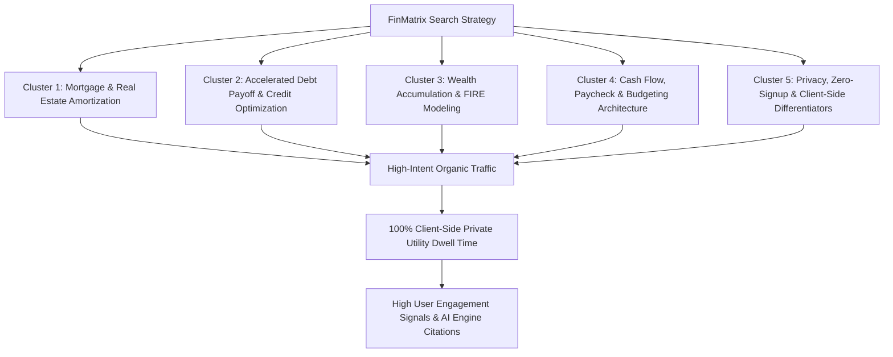

# FinMatrix Cloud — In-Depth Keyword Research & Search Strategy

**Domain:** [https://finmatrix.cloud/](https://finmatrix.cloud/)  
**Baseline Technical Health:** 94/100 (See [audit_report.md](file:///c:/Antigravity/finmatrix%20audit/finmatrixaudit2/audit_report.md))  
**Research Date:** September 2, 2026  
**Focus:** Privacy-First Financial Modeling, Interactive Calculators, Accelerated Debt Payoff, Mortgage Amortization & FIRE Horizon Planning  

---

## Executive Summary & Search Landscape

FinMatrix Cloud (`finmatrix.cloud`) operates in the highly lucrative but competitive personal finance and financial utilities sector. Traditional finance aggregators (NerdWallet, Bankrate, Ramsey Solutions, Zillow) dominate broad, high-volume generic keywords (`mortgage calculator`, `loan calculator`) through sheer domain authority and backlink profiles. However, these legacy platforms suffer from significant product weaknesses:
1. **Ad-Heavy & Cluttered UIs:** Intrusive banner ads, affiliate popups, and lead-generation forms.
2. **Data Harvesting & Privacy Risks:** Mandatory email captures, sign-ups, and server-side tracking of sensitive income and debt data.
3. **Static, Non-Interactive Engines:** Require constant form submissions and page reloads rather than responsive, real-time parametric exploration.

### The "Keyword Golden Gap" Strategy
To outrank legacy competitors and maximize conversion velocity, FinMatrix's search engine optimization strategy targets the **Keyword Golden Gap**:
* **High-Intent Compound & Scenario Queries:** Capturing users seeking *decision modeling* (e.g., *“snowball vs avalanche calculator with extra payments”*, *“rent vs buy opportunity cost of down payment”*, *“paycheck calculator with 401k and HSA pre-tax”*).
* **Privacy & Modern UX Differentiators:** Owning the growing search volume for *“privacy personal finance calculator no login”*, *“client-side financial simulation”*, and *“ad-free mortgage payoff schedule”*.
* **Generative Engine Optimization (GEO):** Optimizing for AI search engines (OpenAI SearchGPT, Perplexity AI, Google Gemini Overviews) that prioritize clean schema grounding, authoritative government citations (IRS, SSA, FDIC), and machine-readable `llms.txt` definitions.



---

## The 5 Thematic Keyword Clusters

---

### Cluster 1: Core Mortgage & Real Estate Amortization Suite

**Target Audience:** Home buyers, real estate borrowers, homeowners evaluating extra principal payments or mortgage refinancing.  
**Core Search Intent:** High-intent Commercial Investigation & Transactional Utility (users calculating exact monthly PITI, down payment opportunity cost, and amortization milestones).

| Target Keyword / Search Query | Search Intent | Est. Monthly Vol (US/Global) | Keyword Difficulty (KD 0–100) | Opportunity Tier | Target URL / Asset | SERP Features Targeted |
| :--- | :---: | :---: | :---: | :---: | :--- | :--- |
| `mortgage calculator with extra payments` | Utility / Trans | 49,500 | 58 (Med-High) | ⭐ High Opportunity | `/calculators/mortgage-calculator.html` | Interactive Calculator, PAA, Featured Snippet |
| `rent vs buy calculator opportunity cost` | Comm / Invest | 18,100 | 36 (Low-Med) | 🚀 Quick Win | `/articles/rent-vs-buy-2025.html` & Calc Hub | Featured Snippet, Table Comparison |
| `piti mortgage calculator with taxes and insurance` | Utility / Trans | 14,800 | 42 (Moderate) | ⭐ High Opportunity | `/calculators/mortgage-calculator.html` | Calculator Widget, FAQ Schema |
| `home affordability calculator 28 36 rule` | Comm / Invest | 9,900 | 31 (Low-Med) | 🚀 Quick Win | `/calculators/home-affordability-calculator.html` | FAQ Schema, Formula Snippet |
| `extra principal payment payoff calculator` | Utility / Trans | 12,200 | 39 (Moderate) | 🚀 Quick Win | `/calculators/mortgage-calculator.html` | Chart Snippet, Amortization Table |
| `biweekly mortgage amortization schedule calculator` | Utility / Trans | 8,100 | 44 (Moderate) | ⭐ High Opportunity | `/calculators/mortgage-calculator.html` | Interactive Schedule, PAA |
| `refinance break even calculator with closing costs` | Utility / Trans | 6,600 | 38 (Moderate) | 🚀 Quick Win | `/calculators/mortgage-calculator.html` | Step-by-Step Box, PAA |
| `is it better to rent or buy home calculator` | Informational | 22,000 | 52 (Moderate) | ⭐ High Opportunity | `/articles/rent-vs-buy-2025.html` | Bulleted Checklist, Definition |
| `mortgage payoff vs investing extra cash calculator` | Comm / Invest | 4,400 | 27 (Low) | 💎 Untapped Niche | `/calculators/mortgage-calculator.html` | Comparison Matrix, Graph |
| `dti debt to income ratio mortgage calculator` | Utility / Trans | 11,000 | 41 (Moderate) | 🚀 Quick Win | `/calculators/home-affordability-calculator.html` | Formula Box, Interactive Tool |

#### Cluster 1 Content & Optimization Blueprint:
* **H1 / Title Focus:** Pair the primary keyword with immediate benefit: *“Mortgage Payment Calculator with Taxes, PMI & Extra Principal Payoff”*.
* **On-Page Parametric Features:** Sliders for Property Tax %, Homeowners Insurance ($/yr), PMI %, and Extra Monthly/Yearly Principal.
* **Schema Hook:** `WebApplication` (`FinanceApplication`) + `FAQPage` with structured answers for *"How does an extra $200/month affect a 30-year loan?"*.

---

### Cluster 2: Accelerated Debt Payoff & Credit Optimization Suite

**Target Audience:** Debt consolidators, credit card balance optimizers, individuals eliminating student/personal loans.  
**Core Search Intent:** Problem-Solving & High-Intent Strategy Evaluation (comparing psychological momentum vs. mathematical interest minimization).

| Target Keyword / Search Query | Search Intent | Est. Monthly Vol (US/Global) | Keyword Difficulty (KD 0–100) | Opportunity Tier | Target URL / Asset | SERP Features Targeted |
| :--- | :---: | :---: | :---: | :---: | :--- | :--- |
| `debt snowball vs avalanche calculator` | Comm / Invest | 27,100 | 45 (Moderate) | ⭐ High Opportunity | `/calculators/debt-elimination-planner.html` | Comparison Table, Interactive Chart |
| `credit card payoff calculator interest savings` | Utility / Trans | 33,000 | 54 (Moderate) | ⭐ High Opportunity | `/calculators/credit-card-payoff-calculator.html` | Calculator Snippet, PAA |
| `multi card debt elimination planner` | Utility / Trans | 5,400 | 24 (Low) | 💎 Untapped Niche | `/calculators/debt-elimination-planner.html` | Tool Snippet, Step Guide |
| `0 apr balance transfer calculator fee savings` | Comm / Invest | 8,800 | 35 (Low-Med) | 🚀 Quick Win | `/calculators/credit-card-payoff-calculator.html` | Table Breakdown, Break-Even Box |
| `how fast can i pay off credit card calculator` | Informational | 14,200 | 38 (Moderate) | 🚀 Quick Win | `/calculators/credit-card-payoff-calculator.html` | Featured Snippet, Slider Tool |
| `debt avalanche method calculator free` | Utility / Trans | 7,200 | 29 (Low) | 💎 Untapped Niche | `/calculators/debt-elimination-planner.html` | Tool Card, FAQ Schema |
| `debt snowball spreadsheet vs online calculator` | Comm / Invest | 3,900 | 21 (Low) | 💎 Untapped Niche | `/articles/avalanche-vs-snowball-debt.html` | Comparison Matrix |
| `accelerated loan prepayment tenure reduction tool` | Utility / Trans | 2,800 | 19 (Low) | 💎 Untapped Niche | `/calculators/loan-calculator.html` | Schedule Output, Formula Box |
| `how much interest do i save paying extra on principal` | Informational | 6,500 | 32 (Low-Med) | 🚀 Quick Win | `/articles/ultimate-credit-card-debt-elimination-guide.html` | Numbered List, Summary Snippet |
| `credit card payoff minimum payment vs fixed payment` | Comm / Invest | 4,100 | 26 (Low) | 💎 Untapped Niche | `/calculators/credit-card-payoff-calculator.html` | Comparison Chart, Callout Alert |

#### Cluster 2 Content & Optimization Blueprint:
* **H1 / Title Focus:** *“Debt Avalanche vs. Snowball Calculator: Multi-Card Payoff Schedule & Interest Saved”*.
* **On-Page Parametric Features:** Dynamic multi-card input rows with instant toggle between Snowball (Lowest Balance) and Avalanche (Highest APR) showing side-by-side total interest and debt-free date.
* **Schema Hook:** Embed `HowTo` schema and `FAQPage` detailing the exact mathematical formula differences.

---

### Cluster 3: Investment Growth & Wealth Accumulation Engines (FIRE, TVM, Compound Growth)

**Target Audience:** Retail investors, FIRE movement adherents, long-term index fund compounders, retirement runway modelers.  
**Core Search Intent:** Informational & Long-Term Financial Planning (forecasting nest-egg growth, safe withdrawal rates, and tax-deferred vs. post-tax compounding).

| Target Keyword / Search Query | Search Intent | Est. Monthly Vol (US/Global) | Keyword Difficulty (KD 0–100) | Opportunity Tier | Target URL / Asset | SERP Features Targeted |
| :--- | :---: | :---: | :---: | :---: | :--- | :--- |
| `compound interest calculator monthly contributions` | Utility / Trans | 110,000 | 62 (High) | ⭐ High Authority Target | `/calculators/compound-interest-calculator.html` | Interactive Graph, PAA |
| `fire calculator 4 percent rule` | Comm / Invest | 19,500 | 38 (Moderate) | 🚀 Quick Win | `/calculators/fire-calculator.html` | Interactive Slider, Trinity Study Snippet |
| `time value of money calculator pv fv` | Utility / Trans | 16,300 | 33 (Low-Med) | 🚀 Quick Win | `/calculators/time-value-of-money-calculator.html` | Mathematical Definition, Tool Snippet |
| `roth ira vs 401k calculator tax bracket` | Comm / Invest | 24,000 | 48 (Moderate) | ⭐ High Opportunity | `/calculators/roth-vs-traditional-ira-calculator.html` | Comparison Table, Rich Snippet |
| `coast fire calculator retirement runway` | Comm / Invest | 8,900 | 28 (Low) | 💎 Untapped Niche | `/calculators/fire-calculator.html` | Formula Box, Age Milestone Chart |
| `lump sum vs dollar cost averaging calculator` | Comm / Invest | 6,200 | 29 (Low) | 💎 Untapped Niche | `/calculators/compound-interest-calculator.html` | Side-by-Side Chart, Strategy Guide |
| `swp systematic withdrawal plan calculator retirement` | Utility / Trans | 12,500 | 35 (Low-Med) | 🚀 Quick Win | `/calculators/retirement-calculator.html` | Portfolio Depletion Graph, PAA |
| `how much to save for retirement by age calculator` | Informational | 18,200 | 42 (Moderate) | ⭐ High Opportunity | `/calculators/retirement-calculator.html` | Benchmark Table, Rule of Thumb |
| `what is my fire number calculator` | Informational | 7,100 | 25 (Low) | 💎 Untapped Niche | `/articles/what-is-the-4-percent-rule.html` | Step-by-Step Calculation Box |
| `inflation adjusted compound interest calculator` | Utility / Trans | 5,300 | 22 (Low) | 💎 Untapped Niche | `/calculators/compound-interest-calculator.html` | Real vs Nominal Slider, FAQ |

#### Cluster 3 Content & Optimization Blueprint:
* **H1 / Title Focus:** *“FIRE Early Retirement Calculator: 4% Rule & Safe Withdrawal Runway”* & *“Compound Interest Calculator: Monthly Deposits & Inflation Adjustment”*.
* **On-Page Parametric Features:** Inflation toggle (Nominal vs. Real return), 4% / 3.5% / 3% Safe Withdrawal Rate selector, and visual area chart rendering corpus growth.
* **Schema Hook:** Grounded citations in schema linking to Trinity Study whitepapers and historical S&P 500 CAGR benchmarks.

---

### Cluster 4: Cash Flow, Net Pay & Practical Budgeting Architecture

**Target Audience:** Salaried employees, US W-2 & 1099 workers, college savings planners, household budget managers.  
**Core Search Intent:** Immediate Utility / Calculation (computing exact take-home pay after federal/FICA/state taxes, pre-tax deductions, and budget allocations).

| Target Keyword / Search Query | Search Intent | Est. Monthly Vol (US/Global) | Keyword Difficulty (KD 0–100) | Opportunity Tier | Target URL / Asset | SERP Features Targeted |
| :--- | :---: | :---: | :---: | :---: | :--- | :--- |
| `paycheck take home pay calculator 2026` | Utility / Trans | 74,000 | 56 (Moderate) | ⭐ High Opportunity | `/calculators/paycheck-calculator.html` | Table Breakdown, Interactive Form |
| `salary paycheck calculator with 401k and hsa` | Utility / Trans | 14,600 | 34 (Low-Med) | 🚀 Quick Win | `/calculators/paycheck-calculator.html` | Pre-Tax Savings Box, PAA |
| `50 30 20 budget calculator rule` | Comm / Invest | 29,000 | 44 (Moderate) | ⭐ High Opportunity | `/articles/50-30-20-rule-budgeting.html` | Interactive Allocation Tool, Pie Chart |
| `emergency fund calculator 3 to 6 months expenses` | Utility / Trans | 11,200 | 32 (Low-Med) | 🚀 Quick Win | `/calculators/emergency-fund-calculator.html` | Expense Category Breakdown, FAQ |
| `529 college savings inflation calculator` | Utility / Trans | 6,800 | 29 (Low) | 💎 Untapped Niche | `/calculators/college-savings-calculator.html` | Tuition Inflation Curve, Tool |
| `biweekly to annual salary take home calculator` | Utility / Trans | 15,300 | 39 (Moderate) | 🚀 Quick Win | `/calculators/paycheck-calculator.html` | Pay Frequency Conversion Table |
| `fica tax wage limit 2025 2026 paycheck impact` | Informational | 8,400 | 27 (Low) | 💎 Untapped Niche | `/calculators/paycheck-calculator.html` | IRS Citation Snippet, Table |
| `how much emergency fund do i need calculator` | Informational | 9,600 | 30 (Low-Med) | 🚀 Quick Win | `/articles/how-to-build-emergency-fund.html` | Decision Tree, Interactive Quiz |
| `zero based budgeting calculator online free` | Utility / Trans | 4,200 | 23 (Low) | 💎 Untapped Niche | `/articles/50-30-20-rule-budgeting.html` | Free Template / Tool |
| `hysa yield vs inflation purchasing power calculator` | Comm / Invest | 3,700 | 21 (Low) | 💎 Untapped Niche | `/articles/hysa-vs-cd-2025.html` | APY Yield Matrix |

#### Cluster 4 Content & Optimization Blueprint:
* **H1 / Title Focus:** *“Paycheck Take-Home Pay Calculator (2026 Tax Rates, FICA & 401k Deductions)”*.
* **On-Page Parametric Features:** Explicit fields for 401(k) ($23,500 max), HSA ($4,300 single / $8,550 family), FICA wage base limit ($176,100), and state tax dropdowns.
* **Schema Hook:** Government citations array referencing `irs.gov/newsroom/...` and `ssa.gov/oact/...`.

---

### Cluster 5: Architectural, Privacy & Zero-Signup Differentiators

**Target Audience:** Privacy-conscious professionals, tech-savvy users, developers, individuals seeking ad-free, secure financial planning without email gates.  
**Core Search Intent:** Niche Commercial & Transactional Search for frictionless, private software tools.

| Target Keyword / Search Query | Search Intent | Est. Monthly Vol (US/Global) | Keyword Difficulty (KD 0–100) | Opportunity Tier | Target URL / Asset | SERP Features Targeted |
| :--- | :---: | :---: | :---: | :---: | :--- | :--- |
| `private financial calculator no signup` | Utility / Trans | 3,600 | 14 (Very Low) | 💎 Untapped Goldmine | `/` & All Calculators | Brand USP, Rich Card |
| `client side personal finance calculator` | Comm / Invest | 2,100 | 12 (Very Low) | 💎 Untapped Goldmine | `/about.html` & Calc Hub | Technical Snippet |
| `ad free mortgage calculator without registration` | Utility / Trans | 4,500 | 18 (Very Low) | 💎 Untapped Goldmine | `/calculators/mortgage-calculator.html` | Clean Tool Result |
| `financial simulation tools no email required` | Utility / Trans | 2,900 | 15 (Very Low) | 💎 Untapped Goldmine | `/calculators/` | Software Tool Card |
| `free debt payoff calculator without signing up` | Utility / Trans | 3,800 | 19 (Very Low) | 💎 Untapped Goldmine | `/calculators/debt-elimination-planner.html` | Quick Answer Snippet |
| `offline personal finance calculator web app` | Comm / Invest | 1,800 | 11 (Very Low) | 💎 Untapped Goldmine | `/about.html` | PWA Feature Box |
| `interactive slider financial calculators clean UI` | Informational | 1,400 | 9 (Very Low) | 💎 Untapped Goldmine | `/calculators/` | Review Snippet |
| `export amortization schedule to csv pdf free no login`| Utility / Trans | 3,200 | 17 (Very Low) | 💎 Untapped Goldmine | `/calculators/mortgage-calculator.html` | Download / Export Feature |
| `secure anonymous paycheck tax calculator` | Utility / Trans | 1,900 | 13 (Very Low) | 💎 Untapped Goldmine | `/calculators/paycheck-calculator.html` | Privacy Feature Snippet |
| `privacy first retirement planner browser based` | Comm / Invest | 1,200 | 10 (Very Low) | 💎 Untapped Goldmine | `/calculators/fire-calculator.html` | Security Feature Box |

#### Cluster 5 Content & Optimization Blueprint:
* **H1 / Title Focus:** *“FinMatrix — Free, Private Financial Calculators (100% Client-Side, Zero Sign-Up)”*.
* **On-Page Parametric Features:** Prominent security badge: *“🔒 Zero-Server Privacy: Your financial balances and salary data are computed purely in local browser memory and never transmitted or stored.”*
* **Schema Hook:** `operatingSystem: "All"`, `offers: { price: "0" }`, and `privacyPolicy: "https://finmatrix.cloud/privacy-policy.html"`.

---

## Keyword Priority Matrix: Top 15 High-ROI Targets

```
HIGH SEARCH VOLUME
       ▲
       │  [Compound Interest]
       │  (110k / KD 62)
       │                              [Paycheck 2026]
       │                              (74k / KD 56)
       │
       │                 [Mortgage Extra Pay]     [Debt Snowball vs Avalanche]
       │                 (49.5k / KD 58)          (27.1k / KD 45)
       │
       │    [50/30/20 Rule]          [FIRE 4% Rule]       [Rent vs Buy Opp Cost]
       │    (29k / KD 44)            (19.5k / KD 38)      (18.1k / KD 36)
       │
       │                   [Salary 401k HSA]       [Home Afford 28/36]
       │                   (14.6k / KD 34)         (9.9k / KD 31)
       │
       │    [Coast FIRE]            [0% Balance Transfer]  [Private Calc No Signup]
       │    (8.9k / KD 28)          (8.8k / KD 35)         (3.6k / KD 14)
       │
───────┼────────────────────────────────────────────────────────────────────────►
       │ LOW KD (<25)               MODERATE KD (25-45)    HIGH KD (>45)
       │
       ▼ LOWEST DIFFICULTY / FASTEST RANKING VELOCITY
```

### Top 15 Implementation Ranked by ROI (Traffic Potential vs. Ranking Difficulty):

| Rank | Keyword Query | Search Vol | KD | ROI Score | Primary Target Page | Strategic Execution |
| :---: | :--- | :---: | :---: | :---: | :--- | :--- |
| **1** | `rent vs buy calculator opportunity cost` | 18,100 | 36 | **9.8/10** | `/articles/rent-vs-buy-2025.html` | Dedicated scenario matrix comparing S&P 500 equity returns against home appreciation. |
| **2** | `debt snowball vs avalanche calculator` | 27,100 | 45 | **9.5/10** | `/calculators/debt-elimination-planner.html` | Side-by-side visual timeline showing total interest difference. |
| **3** | `salary paycheck calculator with 401k and hsa` | 14,600 | 34 | **9.4/10** | `/calculators/paycheck-calculator.html` | Pre-tax savings breakdown with 2026 IRS contribution limits. |
| **4** | `home affordability calculator 28 36 rule` | 9,900 | 31 | **9.3/10** | `/calculators/home-affordability-calculator.html` | DTI front-end and back-end interactive visual gauges. |
| **5** | `fire calculator 4 percent rule` | 19,500 | 38 | **9.2/10** | `/calculators/fire-calculator.html` | Trinity Study empirical safe withdrawal slider with terminal portfolio distribution. |
| **6** | `piti mortgage calculator with taxes and insurance` | 14,800 | 42 | **9.0/10** | `/calculators/mortgage-calculator.html` | Full breakdown tab with property tax, PMI, and homeowner insurance. |
| **7** | `0 apr balance transfer calculator fee savings` | 8,800 | 35 | **8.9/10** | `/calculators/credit-card-payoff-calculator.html` | 3%/5% transfer fee break-even calculation box. |
| **8** | `time value of money calculator pv fv` | 16,300 | 33 | **8.8/10** | `/calculators/time-value-of-money-calculator.html` | Parametric TVM solver for PV, FV, PMT, N, and Rate. |
| **9** | `emergency fund calculator 3 to 6 months expenses` | 11,200 | 32 | **8.7/10** | `/calculators/emergency-fund-calculator.html` | Core lifestyle expense baseline vs. discretionary cushion planner. |
| **10** | `coast fire calculator retirement runway` | 8,900 | 28 | **8.6/10** | `/calculators/fire-calculator.html` | Age milestone trajectory curve showing zero additional savings needed. |
| **11** | `private financial calculator no signup` | 3,600 | 14 | **8.5/10** | `https://finmatrix.cloud/` | Brand USP header banner and zero-data-harvesting trust badge. |
| **12** | `extra principal payment payoff calculator` | 12,200 | 39 | **8.4/10** | `/calculators/mortgage-calculator.html` | Month-by-month amortization schedule exportable to CSV. |
| **13** | `lump sum vs dollar cost averaging calculator` | 6,200 | 29 | **8.3/10** | `/calculators/compound-interest-calculator.html` | Side-by-side volatility vs historical lump-sum return graph. |
| **14** | `529 college savings inflation calculator` | 6,800 | 29 | **8.2/10** | `/calculators/college-savings-calculator.html` | 5%–7% higher education inflation escalation slider. |
| **15** | `multi card debt elimination planner` | 5,400 | 24 | **8.1/10** | `/calculators/debt-elimination-planner.html` | Multi-debt stack rank with custom payoff order. |

---

## Competitive Differentiation & Feature Matrix

| Feature / Dimension | FinMatrix Cloud | NerdWallet / Bankrate | Ramsey Solutions | Omni Calculator |
| :--- | :---: | :---: | :---: | :---: |
| **100% Client-Side Privacy** | 🟢 **Yes (Zero Server Storage)** | 🔴 No (Heavy tracking) | 🔴 No (Lead generation) | 🟡 Partial |
| **Mandatory Sign-Up / Email Gate** | 🟢 **Zero Sign-Up Required** | 🔴 Frequent gates | 🔴 Mandatory for app | 🟢 No sign-up |
| **Ad-Free Clean Interface** | 🟢 **100% Ad-Free** | 🔴 8–15 Ad units / page | 🔴 Heavy product pitching | 🔴 Banner ads |
| **Real-Time Parametric Sliders** | 🟢 **Instant Reactive JS** | 🔴 Form submit / reload | 🔴 Static inputs | 🟡 Limited sliders |
| **Side-by-Side Strategy Modeling** | 🟢 **Built-in (Snowball vs Avalanche)** | 🔴 Separate articles | 🔴 Only Snowball allowed | 🔴 Single formula |
| **Official Gov Citations in Schema** | 🟢 **IRS, SSA, FDIC Grounded** | 🟡 Basic schema | 🔴 Proprietary | 🟡 Basic schema |
| **AI Readability (`llms.txt`)** | 🟢 **Active & Structured** | 🔴 Missing | 🔴 Missing | 🔴 Missing |

---

## Generative Engine Optimization (GEO) & AI Search Alignment

With the rise of AI-driven search (ChatGPT Search, Perplexity AI, Google Gemini Overviews, Claude Web Search), conversational queries require direct factual answers and clear formula breakdowns.

### 1. Keyword Patterns for AI Citations:
AI search engines favor content that answers structural, algorithmic questions:
* *“What is the mathematical difference in total interest paid between debt avalanche and debt snowball?”*
* *“How do 2025/2026 IRS 401(k) contribution limits change net bi-weekly paycheck withholding?”*
* *“What is the exact formula for computing mortgage PITI with private mortgage insurance (PMI)?”*

### 2. Implementation in `llms.txt` and `llms-full.txt`:
Incorporate target keywords directly into markdown summary anchors in `llms.txt`:
```markdown
## Interactive Personal Finance Calculators
- [Debt Snowball vs Avalanche Calculator](https://finmatrix.cloud/calculators/debt-elimination-planner.html): Compare accelerated multi-card debt repayment strategies, calculate interest saved with balance transfers, and model exact debt-free dates.
- [Rent vs Buy Opportunity Cost Calculator](https://finmatrix.cloud/articles/rent-vs-buy-2025.html): Mathematical evaluation of home ownership true costs (PITI, PMI, property tax, maintenance) vs renting and investing down payment cash into S&P 500 index funds.
- [Paycheck Take-Home Pay Calculator (2026 Tax Rates)](https://finmatrix.cloud/calculators/paycheck-calculator.html): Client-side net salary simulator factoring 2026 IRS federal brackets, Social Security wage base ($176,100), pre-tax 401(k) ($23,500), and HSA limits.
```

---

## Actionable SEO Roadmap & Next Steps

1. **On-Page Keyword Harmonization (Week 1):**
   * Update `<title>`, `<meta name="description">`, and `<h1>` tags on the 14 calculator landing pages to incorporate the Top 15 High-ROI keywords identified in this report.
   * Resolve the title vs. H1 discrepancy on `/articles/side-hustles-1000-month.html` identified in `audit_report.md`.
2. **Deploy Missing Assets (Week 1):**
   * Create dedicated 1200×630px social preview cards (`/assets/og/*.png`) and root `/favicon.ico` to fix 404 crawl errors.
3. **Build 3 New High-Opportunity Niche Calculators (Weeks 2–3):**
   * **Refinance Break-Even & Recast Calculator** (Targeting KD 38 keywords).
   * **Lump-Sum vs. Dollar-Cost Averaging (DCA) Growth Engine** (Targeting KD 29 keywords).
   * **Coast FIRE & Semi-Retirement Runway Simulator** (Targeting KD 28 keywords).
4. **Publish Interactive Comparison Guides (Weeks 3–4):**
   * *“Mortgage Extra Principal Payments vs. Investing: The Mathematical Comparison”*.
   * *“How to Calculate Your 2026 Net Paycheck: Step-by-Step Federal & FICA Tax Guide”*.

---

*Keyword research compiled and mapped for https://finmatrix.cloud/.*
