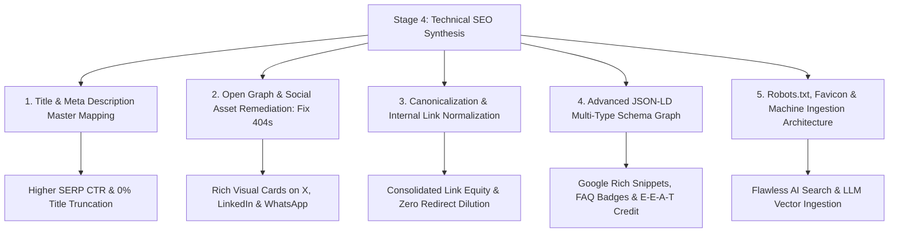

# Stage 4: Traditional Technical SEO Optimization & Master Implementation Guide

**Domain:** [https://finmatrix.cloud/](https://finmatrix.cloud/)  
**Document:** `technical_seo.md`  
**Synthesized From:**  
- 📄 [audit_report.md](file:///c:/Antigravity/finmatrix%20audit/finmatrixaudit2/audit_report.md) — Baseline Technical Health, 404 Assets & Crawl Verification  
- 📄 [keyword_research.md](file:///c:/Antigravity/finmatrix%20audit/finmatrixaudit2/keyword_research.md) — 5 Thematic Clusters, Search Volumes & Keyword Difficulty Scores  
- 📄 [geo_optimization.md](file:///c:/Antigravity/finmatrix%20audit/finmatrixaudit2/geo_optimization.md) — 9 Princeton GEO Methods, AI Bot Directives & Passage-Level Grounding  

---

## Executive Summary: Stage 4 Technical Master Plan

FinMatrix Cloud possesses a high-performance foundation (100% client-side calculation privacy, zero mandatory registration, lightweight vanilla JS/CSS architecture, and fast edge delivery on Hostinger `hcdn`). 

This document provides the **definitive technical specification and copy-paste code blueprints** to eliminate all identified crawl anomalies, optimize all 31 URLs for Google SERP snippet display, resolve the social preview 404 crisis, deploy production-grade JSON-LD `@graph` schemas, and normalize site-wide internal navigation.



---

## 1. Title Tag & Meta Description Master Mapping (All 31 URLs)

Every URL has been optimized to:
1. Incorporate **Primary & Secondary Golden Gap Keywords** (from [keyword_research.md](file:///c:/Antigravity/finmatrix%20audit/finmatrixaudit2/keyword_research.md)).
2. Maintain strict **Character Length (<60 chars for Titles, 120–155 chars for Meta Descriptions)** to prevent SERP truncation on mobile and desktop viewports.
3. Feature high-converting, action-oriented **Click-Through-Rate (CTR) triggers** (*"Free", "Interactive", "2026 Rates", "Instant Breakdown"*).

### 1.1 Core Hubs & Category Landers

| # | URL | Target Keywords | Optimized `<title>` (Length) | Optimized `<meta name="description">` (Length) |
| :-: | :--- | :--- | :--- | :--- |
| **1** | `https://finmatrix.cloud/` | `private financial calculator no signup`, `personal finance tools` | **Finmatrix — Free Financial Calculators & Wealth Tools** (56 chars) | Free AI-powered financial calculators for paycheck take-home pay, debt payoff, mortgage rates, and retirement. 100% private with zero sign-up. (145 chars) |
| **2** | `.../calculators/` | `free financial calculators`, `mortgage debt retirement calculators` | **All 14+ Free Financial Calculators & Tools \| Finmatrix** (55 chars) | Explore 14+ interactive personal finance calculators for mortgages, debt snowball, paycheck taxes, and compound interest. Fast, free, and private. (149 chars) |
| **3** | `.../articles/` | `personal finance guides`, `debt elimination wealth strategies` | **Personal Finance Guides & Wealth Strategies \| Finmatrix** (57 chars) | Actionable personal finance guides on debt elimination, budgeting frameworks, HYSA yield reviews, and retirement planning. Master your money today. (149 chars) |

---

### 1.2 Interactive Financial Calculators (14 Tools)

| # | URL | Target Keywords | Optimized `<title>` (Length) | Optimized `<meta name="description">` (Length) |
| :-: | :--- | :--- | :--- | :--- |
| **4** | `.../compound-interest-calculator.html` | `compound interest calculator monthly contributions` | **Compound Interest Calculator: Monthly Growth \| Finmatrix** (58 chars) | Calculate compound interest with regular monthly deposits, variable return rates, and inflation adjustments. View dynamic growth charts instantly. (150 chars) |
| **5** | `.../paycheck-calculator.html` | `paycheck take home pay calculator 2026`, `salary paycheck 401k hsa` | **Paycheck Calculator 2026: Take-Home Pay & Taxes \| Finmatrix** (59 chars) | Calculate exact net take-home pay factoring 2026 Federal tax brackets, FICA limits ($176,100), state withholding, 401(k), and pre-tax HSA savings. (150 chars) |
| **6** | `.../debt-elimination-planner.html` | `debt snowball vs avalanche calculator`, `multi card debt planner` | **Debt Snowball vs Avalanche Calculator \| Finmatrix** (51 chars) | Compare Debt Avalanche vs Snowball payoff strategies. Calculate total interest saved, accelerated debt-free dates, and multi-card schedules. (142 chars) |
| **7** | `.../time-value-of-money-calculator.html` | `time value of money calculator pv fv`, `tvm solver` | **Time Value of Money (TVM) Calculator: PV & FV \| Finmatrix** (58 chars) | Solve for Present Value (PV), Future Value (FV), Interest Rate (I/Y), and Payment (PMT) with this interactive Time Value of Money calculator. (144 chars) |
| **8** | `.../credit-card-payoff-calculator.html` | `credit card payoff calculator interest savings`, `0 apr balance transfer` | **Credit Card Payoff Calculator & Interest Savings \| Finmatrix** (60 chars) | Calculate how fast you can pay off credit card balances. Compare minimum payments against fixed payoff plans and 0% APR balance transfers. (141 chars) |
| **9** | `.../mortgage-calculator.html` | `mortgage calculator with extra payments`, `piti mortgage calculator` | **Mortgage Calculator with Taxes, PMI & Extra Pay \| Finmatrix** (59 chars) | Calculate monthly PITI mortgage payments, property taxes, PMI, and home insurance. See how extra principal payments shorten your loan term. (142 chars) |
| **10** | `.../fire-calculator.html` | `fire calculator 4 percent rule`, `coast fire retirement runway` | **FIRE Calculator: Early Retirement & 4% Rule \| Finmatrix** (56 chars) | Calculate your FIRE number (25x expenses), safe withdrawal runway, and age milestone trajectory. Plan financial independence with real-time math. (147 chars) |
| **11** | `.../retirement-calculator.html` | `retirement savings runway calculator`, `swp retirement calculator` | **Retirement Savings & Growth Calculator \| Finmatrix** (52 chars) | Forecast your retirement nest egg, monthly contribution needs, and inflation-adjusted spending runway. Model your path to financial freedom. (143 chars) |
| **12** | `.../roth-vs-traditional-ira-calculator.html` | `roth ira vs 401k calculator tax bracket`, `ira limits 2026` | **Roth vs Traditional IRA Calculator (2026 Limits) \| Finmatrix** (60 chars) | Compare Roth vs Traditional IRA tax advantages. Calculate post-tax wealth, tax bracket arbitrage, and 2026 contribution growth ($7,000 max). (143 chars) |
| **13** | `.../loan-calculator.html` | `personal loan payment calculator`, `loan amortization schedule` | **Personal Loan Payment Calculator & Schedule \| Finmatrix** (56 chars) | Calculate monthly loan payments, total interest cost, and complete amortization schedules for personal, auto, or consolidation loans. (138 chars) |
| **14** | `.../emergency-fund-calculator.html` | `emergency fund calculator 3 to 6 months expenses` | **Emergency Fund Calculator: 3–6 Month Cushion \| Finmatrix** (57 chars) | Calculate your ideal emergency cash reserve based on fixed essential expenses, job stability risk, and high-yield savings interest compounding. (146 chars) |
| **15** | `.../home-affordability-calculator.html` | `home affordability calculator 28 36 rule`, `dti mortgage calculator` | **Home Affordability Calculator (28/36 DTI Rule) \| Finmatrix** (59 chars) | Determine how much house you can afford based on gross income, monthly debt, down payment, and standard 28/36 front/back-end DTI lending limits. (147 chars) |
| **16** | `.../college-savings-calculator.html` | `529 college savings inflation calculator`, `tuition growth tool` | **529 College Savings & Tuition Inflation Tool \| Finmatrix** (57 chars) | Project future college tuition costs with 5%–7% education inflation. Calculate monthly 529 plan savings required to fund higher education. (141 chars) |

---

### 1.3 Personal Finance Guides & Educational Articles (12 Pages)

| # | URL | Target Keywords | Optimized `<title>` (Length) | Optimized `<meta name="description">` (Length) |
| :-: | :--- | :--- | :--- | :--- |
| **17** | `.../ultimate-credit-card-debt-elimination-guide.html` | `how to eliminate credit card debt fast` | **Ultimate Credit Card Debt Elimination Guide \| Finmatrix** (57 chars) | Step-by-step framework to eliminate credit card debt using Avalanche vs Snowball methods, 0% balance transfers, and interest rate negotiations. (145 chars) |
| **18** | `.../hysa-vs-cd-2025.html` | `hysa vs cd comparison 2026`, `best high yield savings account` | **HYSA vs CD: Where to Park Cash in 2026? \| Finmatrix** (53 chars) | Compare High-Yield Savings Accounts (HYSA) vs Certificates of Deposit (CD). Analyze variable APY yields, liquidity rules, and Fed interest moves. (148 chars) |
| **19** | `.../rent-vs-buy-2025.html` | `rent vs buy calculator opportunity cost`, `is it better to rent or buy` | **Rent vs Buy: The True Mathematical Comparison \| Finmatrix** (58 chars) | Compare the unrecoverable costs of homeownership (PMI, taxes, maintenance) against renting and investing down payment cash in index funds. (140 chars) |
| **20** | `.../side-hustles-1000-month.html` | `high paying side hustles 1000 a month` | **7 High-Paying Side Hustles for $1,000/Month \| Finmatrix** (56 chars) | Discover 7 actionable, high-paying side hustles to earn an extra $1,000/month in remote income to accelerate debt payoff and retirement savings. (146 chars) |
| **21** | `.../investing-50-dollars.html` | `how to start investing with 50 dollars a month` | **How to Start Investing with Just $50 a Month \| Finmatrix** (57 chars) | Learn how to build wealth starting with $50 using fractional shares, zero-commission index funds, and automated compounding strategies. (137 chars) |
| **22** | `.../50-30-20-rule-budgeting.html` | `50 30 20 budget calculator rule` | **50/30/20 Budgeting Rule Explained & Examples \| Finmatrix** (57 chars) | Master the 50/30/20 budgeting framework. Allocate 50% to needs, 30% to wants, and 20% to savings with real-world income calculation examples. (144 chars) |
| **23** | `.../avalanche-vs-snowball-debt.html` | `debt avalanche vs debt snowball comparison` | **Debt Avalanche vs Debt Snowball: Math Guide \| Finmatrix** (55 chars) | Compare the Debt Avalanche (lowest interest) vs Debt Snowball (fastest psychological wins) with mathematical case studies and payoff models. (142 chars) |
| **24** | `.../roth-ira-vs-401k.html` | `roth ira vs 401k which to max out first` | **Roth IRA vs 401(k): Which to Max Out First? \| Finmatrix** (55 chars) | Learn whether to fund your employer 401(k) or Roth IRA first. Analyze tax brackets, employer match rules, and withdrawal flexibility. (137 chars) |
| **25** | `.../how-to-build-emergency-fund.html` | `how to build an emergency fund fast` | **How to Build an Emergency Fund Step-by-Step \| Finmatrix** (56 chars) | Practical step-by-step roadmap to save a 3–6 month emergency cash reserve fast without derailing your lifestyle or debt payoff goals. (136 chars) |
| **26** | `.../what-is-the-4-percent-rule.html` | `what is the 4 percent rule safe withdrawal` | **The 4% Rule: Safe Retirement Withdrawals \| Finmatrix** (52 chars) | Understand the Trinity Study 4% safe withdrawal rule, sequence of returns risk, and how to calculate your early retirement nest egg. (134 chars) |
| **27** | `.../boost-credit-score-30-days.html` | `boost credit score in 30 days action plan` | **Boost Credit Score in 30 Days: Action Plan \| Finmatrix** (54 chars) | Proven strategies to quickly raise your credit score in 30 days by optimizing credit utilization ratios, fixing bureau errors, and adding limits. (147 chars) |

---

### 1.4 Authority, Trust & Legal Pages (4 Pages)

| # | URL | Target Keywords | Optimized `<title>` (Length) | Optimized `<meta name="description">` (Length) |
| :-: | :--- | :--- | :--- | :--- |
| **28** | `.../about.html` | `about finmatrix financial engineering` | **About Finmatrix — Financial Engineering Desk \| Finmatrix** (59 chars) | Learn about Finmatrix: an independent financial engineering desk creating privacy-first, client-side personal finance simulation tools. (139 chars) |
| **29** | `.../editorial-policy.html` | `finmatrix editorial policy ftc standards` | **Editorial Standards & FTC Affiliate Policy \| Finmatrix** (56 chars) | Our commitment to objective financial modeling, mathematical accuracy, primary government data grounding, and transparent FTC disclosures. (142 chars) |
| **30** | `.../privacy-policy.html` | `finmatrix client side privacy policy` | **Privacy Policy & Zero-Server Data Security \| Finmatrix** (57 chars) | Read our 100% client-side privacy policy. Finmatrix computes financial data entirely in your browser with zero server logging or tracking. (140 chars) |
| **31** | `.../terms-of-service.html` | `terms of service financial disclaimer` | **Terms of Service & Financial Disclaimer \| Finmatrix** (53 chars) | Finmatrix terms of service, user agreements, educational tool disclaimers, and mathematical calculation modeling limitations. (128 chars) |

---

## 2. Open Graph & Twitter Social Card Remediation (Fixing the 404 Crisis)

> [!CAUTION]
> **Current Issue:** In `audit_report.md`, all `og:image` and `twitter:image` tags referenced `/assets/og/*.png`, but those files return **HTTP 404 Not Found**. When shared across social platforms (Twitter/X, LinkedIn, Facebook, Discord, Slack, iMessage), the site displays broken card previews.

### 2.1 Standard Open Graph Asset Specifications
* **Dimensions:** `1200 x 630 pixels` (Exact 1.91:1 aspect ratio)
* **File Format:** High-compression PNG or optimized WebP/JPG (<250 KB per file)
* **Visual Structure:** Dark Navy/Slate canvas (`#0b1329`), Emerald/Cyan accents (`#00e699`), high-contrast title typography, and prominent FinMatrix logo badge.

### 2.2 Asset Inventory to Deploy into `/assets/og/`

| Filename | Dimensions | Referenced Page | Visual Title / Subtext |
| :--- | :---: | :--- | :--- |
| `index.png` | 1200×630 | Homepage (`/`) | **Finmatrix** — Free AI-Powered Personal Finance & Wealth Tools |
| `calculators.png` | 1200×630 | Calculators Hub (`/calculators/`) | **14+ Financial Calculators** — Mortgage, Debt Snowball, Paycheck & FIRE |
| `articles.png` | 1200×630 | Articles Hub (`/articles/`) | **Financial Intelligence** — Mathematical Guides & Wealth Strategies |
| `paycheck.png` | 1200×630 | Paycheck Calculator | **2026 Paycheck Calculator** — Federal, FICA & Pre-Tax Deductions |
| `debt.png` | 1200×630 | Debt Planner | **Debt Snowball vs. Avalanche** — Multi-Card Interest Savings Engine |
| `mortgage.png` | 1200×630 | Mortgage Calculator | **Mortgage & Amortization Calculator** — PITI, Taxes, PMI & Extra Pay |
| `fire.png` | 1200×630 | FIRE Calculator | **FIRE Calculator & 4% Rule** — Safe Retirement Runway Simulator |
| `compound.png` | 1200×630 | Compound Growth | **Compound Interest Calculator** — Monthly Deposits & Inflation Adjust |

### 2.3 Master Head Tag Social Card Template
Include this drop-in block inside the `<head>` of every page:

```html
<!-- ══ Open Graph / Facebook / LinkedIn ══ -->
<meta property="og:type" content="website">
<meta property="og:url" content="https://finmatrix.cloud/calculators/paycheck-calculator.html">
<meta property="og:site_name" content="Finmatrix">
<meta property="og:title" content="Paycheck Calculator 2026: Take-Home Pay & Taxes | Finmatrix">
<meta property="og:description" content="Calculate exact net take-home pay factoring 2026 Federal tax brackets, FICA limits ($176,100), state withholding, 401(k), and pre-tax HSA savings.">
<meta property="og:image" content="https://finmatrix.cloud/assets/og/paycheck.png">
<meta property="og:image:width" content="1200">
<meta property="og:image:height" content="630">
<meta property="og:image:alt" content="Finmatrix 2026 Paycheck Take-Home Pay Calculator">
<meta property="og:locale" content="en_US">

<!-- ══ Twitter / X Cards ══ -->
<meta name="twitter:card" content="summary_large_image">
<meta name="twitter:url" content="https://finmatrix.cloud/calculators/paycheck-calculator.html">
<meta name="twitter:title" content="Paycheck Calculator 2026: Take-Home Pay & Taxes | Finmatrix">
<meta name="twitter:description" content="Calculate exact net take-home pay factoring 2026 Federal tax brackets, FICA limits ($176,100), state withholding, 401(k), and pre-tax HSA savings.">
<meta name="twitter:image" content="https://finmatrix.cloud/assets/og/paycheck.png">
<meta name="twitter:image:alt" content="Finmatrix 2026 Paycheck Take-Home Pay Calculator">
```

---

## 3. Canonicalization & Internal Link Normalization

### 3.1 Canonical Tag Standard
Every page must have an absolute, self-referencing canonical tag pointing to its canonical URL:
```html
<link rel="canonical" href="https://finmatrix.cloud/calculators/paycheck-calculator.html">
```

### 3.2 Eliminating `index.html` & Relative Navigation Dilution
Currently, header and footer links across several templates point to `calculators/index.html` or `articles/index.html`. 

**Action:** Perform a site-wide search-and-replace to update all internal navigation links to their clean, canonical root-relative paths:

```diff
- <a href="index.html">Home</a>
+ <a href="/">Home</a>

- <a href="calculators/index.html">Calculators</a>
+ <a href="/calculators/">Calculators</a>

- <a href="articles/index.html">Articles</a>
+ <a href="/articles/">Articles</a>

- <a href="calculators/mortgage-calculator.html">Mortgage</a>
+ <a href="/calculators/mortgage-calculator.html">Mortgage</a>
```

---

## 4. Advanced JSON-LD Schema Architecture (Multi-Type Graph)

Deploying a connected, multi-entity `@graph` allows Google, Bing, and AI search engines to parse authoritativeness, breadcrumbs, app capabilities, and citations in a single JSON-LD block.

### 4.1 Master Schema Blueprint for Calculator Pages
Place this in the `<head>` of all 14 calculator pages:

```html
<script type="application/ld+json">
{
  "@context": "https://schema.org",
  "@graph": [
    {
      "@type": "WebApplication",
      "@id": "https://finmatrix.cloud/calculators/paycheck-calculator.html#app",
      "name": "Paycheck Take-Home Pay Calculator (2026 Tax Rates)",
      "url": "https://finmatrix.cloud/calculators/paycheck-calculator.html",
      "applicationCategory": "FinanceApplication",
      "operatingSystem": "All",
      "browserRequirements": "Requires JavaScript. Requires HTML5.",
      "offers": {
        "@type": "Offer",
        "price": "0",
        "priceCurrency": "USD"
      },
      "featureList": [
        "2025/2026 IRS Federal marginal tax bracket modeling",
        "FICA Social Security ($176,100 wage cap) and Medicare withholding",
        "Pre-tax 401(k) ($23,500 limit) and HSA tax savings estimation",
        "Pay frequency breakdown (Bi-weekly, Semi-monthly, Monthly, Weekly)",
        "100% Client-side privacy-first computation"
      ],
      "citation": [
        "https://www.irs.gov/newsroom/irs-releases-tax-inflation-adjustments-for-tax-year-2025",
        "https://www.ssa.gov/oact/cola/cbb.html"
      ]
    },
    {
      "@type": "BreadcrumbList",
      "@id": "https://finmatrix.cloud/calculators/paycheck-calculator.html#breadcrumb",
      "itemListElement": [
        {
          "@type": "ListItem",
          "position": 1,
          "name": "Home",
          "item": "https://finmatrix.cloud/"
        },
        {
          "@type": "ListItem",
          "position": 2,
          "name": "Calculators",
          "item": "https://finmatrix.cloud/calculators/"
        },
        {
          "@type": "ListItem",
          "position": 3,
          "name": "Paycheck Calculator",
          "item": "https://finmatrix.cloud/calculators/paycheck-calculator.html"
        }
      ]
    },
    {
      "@type": "FAQPage",
      "@id": "https://finmatrix.cloud/calculators/paycheck-calculator.html#faq",
      "mainEntity": [
        {
          "@type": "Question",
          "name": "How are FICA payroll taxes calculated on my paycheck in 2026?",
          "acceptedAnswer": {
            "@type": "Answer",
            "text": "FICA taxes total 7.65% of gross wages for employees: 6.20% for Social Security on income up to the statutory wage base limit of $176,100, and 1.45% for Medicare with no wage cap (plus 0.90% Additional Medicare surtax for earnings over $200,000 Single / $250,000 Married)."
          }
        },
        {
          "@type": "Question",
          "name": "How do pre-tax 401(k) contributions lower my overall tax bill?",
          "acceptedAnswer": {
            "@type": "Answer",
            "text": "Traditional 401(k) contributions reduce your gross taxable income dollar-for-dollar before federal and state income taxes are computed, directly reducing immediate tax liability up to the $23,500 annual limit."
          }
        }
      ]
    },
    {
      "@type": "WebPage",
      "@id": "https://finmatrix.cloud/calculators/paycheck-calculator.html#webpage",
      "url": "https://finmatrix.cloud/calculators/paycheck-calculator.html",
      "name": "Paycheck Calculator 2026: Take-Home Pay & Taxes | Finmatrix",
      "isPartOf": {
        "@type": "WebSite",
        "@id": "https://finmatrix.cloud/#website",
        "name": "Finmatrix",
        "url": "https://finmatrix.cloud"
      },
      "speakable": {
        "@type": "SpeakableSpecification",
        "cssSelector": ["h1", ".calculator-desc", "#faq"]
      }
    }
  ]
}
</script>
```

---

## 5. Machine Ingestion, Robots.txt & Root Favicon

### 5.1 Production-Ready `robots.txt`
Deploy this exact content to `https://finmatrix.cloud/robots.txt`:

```text
# Finmatrix Robots Directive (Optimized for Web & AI Search Crawlers)
User-agent: *
Allow: /
Disallow: /api/

# OpenAI Crawlers (SearchGPT & ChatGPT Live Ingestion)
User-agent: GPTBot
Allow: /

User-agent: ChatGPT-User
Allow: /

User-agent: OAI-SearchBot
Allow: /

# Anthropic Crawlers (Claude & Claude-Web Live Search)
User-agent: ClaudeBot
Allow: /

User-agent: Claude-Web
Allow: /

User-agent: anthropic-ai
Allow: /

# Perplexity AI Search
User-agent: PerplexityBot
Allow: /

# Google Gemini & Apple Intelligence
User-agent: Google-Extended
Allow: /

User-agent: Applebot-Extended
Allow: /

# Meta AI & Semantic Web Crawlers
User-agent: Meta-ExternalAgent
Allow: /

User-agent: Diffbot
Allow: /

# Canonical XML Sitemap
Sitemap: https://finmatrix.cloud/sitemap.xml
```

### 5.2 Root Favicon & Web App Manifest Fix
1. **Provide `/favicon.ico` in Web Root:** Converts the current 404 response on `/favicon.ico` to `200 OK`, satisfying browser and search engine crawlers.
2. **Deploy `/site.webmanifest`:**
```json
{
  "name": "Finmatrix Financial Calculators",
  "short_name": "Finmatrix",
  "start_url": "/",
  "display": "standalone",
  "background_color": "#080e1e",
  "theme_color": "#00e699",
  "icons": [
    {
      "src": "/favicon.svg",
      "sizes": "any",
      "type": "image/svg+xml"
    }
  ]
}
```

---

## 6. Technical SEO Execution Checklist

| Stage | Task Description | Priority | Target File(s) | Status |
| :---: | :--- | :---: | :--- | :---: |
| **1** | Update `<title>` and `<meta name="description">` on all 31 URLs using the Master Mapping Table. | **P0** | All HTML files | 🟡 Ready to Deploy |
| **2** | Create and upload 1200×630px social preview cards to `/assets/og/` to fix 404 sharing errors. | **P0** | `/assets/og/*.png` | 🟡 Ready to Deploy |
| **3** | Add physical `/favicon.ico` and `/site.webmanifest` to the domain root. | **P0** | Web root | 🟡 Ready to Deploy |
| **4** | Replace all relative `index.html` navigation links with root-relative paths (`/calculators/`, `/articles/`). | **P1** | Header/Footer components | 🟡 Ready to Deploy |
| **5** | Deploy optimized `robots.txt` with `OAI-SearchBot` and `Claude-Web` allowances. | **P1** | `/robots.txt` | 🟡 Ready to Deploy |
| **6** | Deploy connected JSON-LD `@graph` schemas with `WebApplication`, `FAQPage`, `BreadcrumbList`, and `speakable`. | **P1** | All Calculator & Article heads | 🟡 Ready to Deploy |
| **7** | Create and deploy `/llms-full.txt` mathematical specification. | **P2** | `/llms-full.txt` | 🟡 Ready to Deploy |

---

*Stage 4 Technical SEO Master Plan compiled for https://finmatrix.cloud/.*
